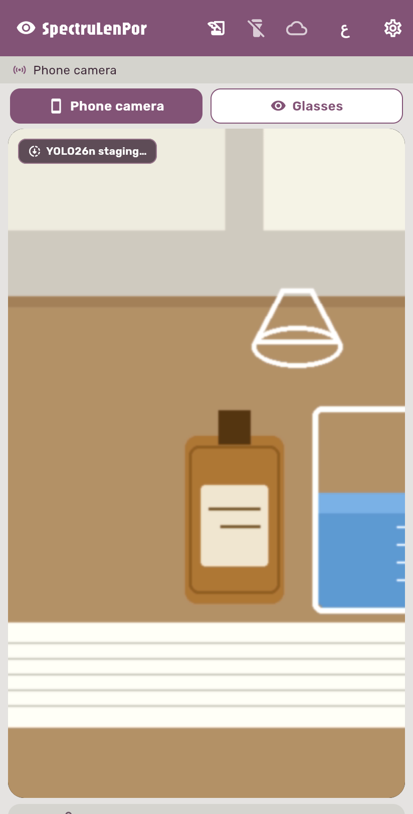
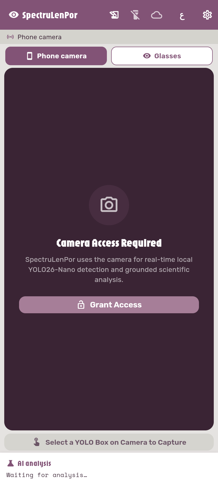
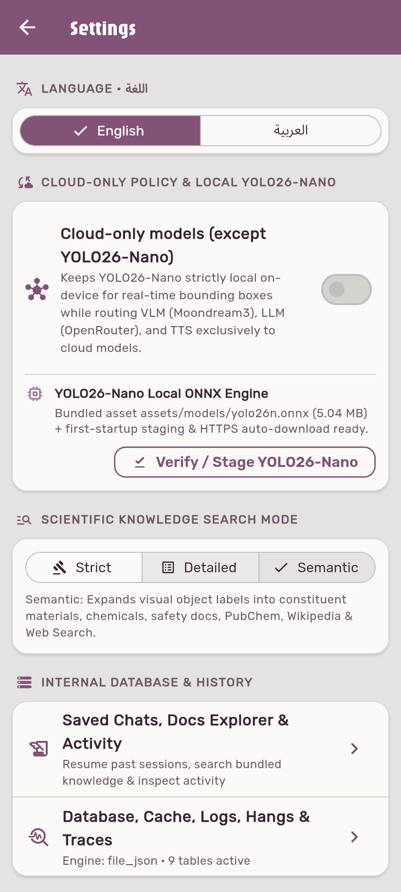
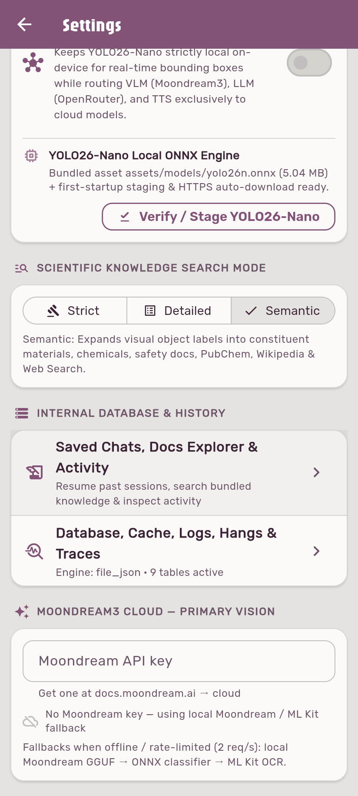
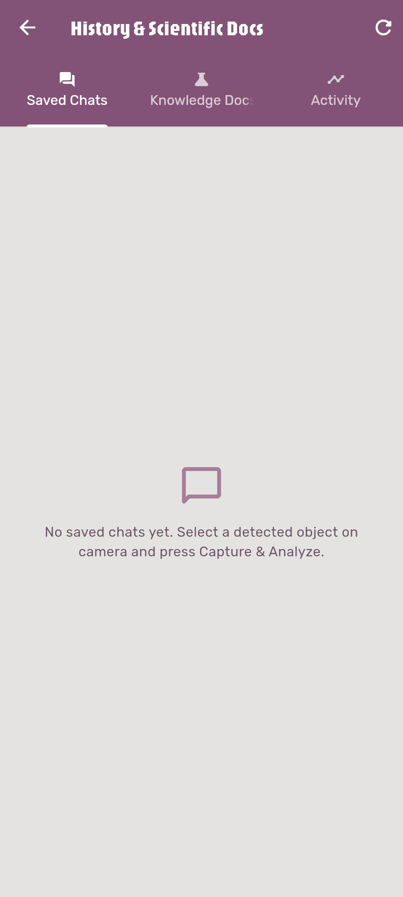
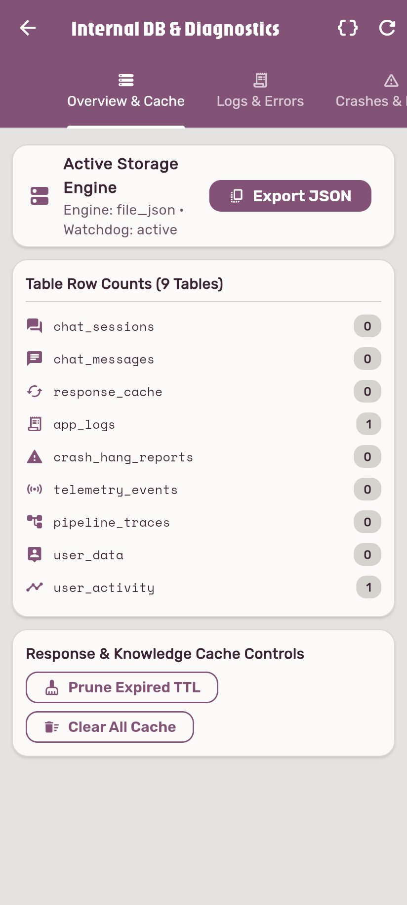
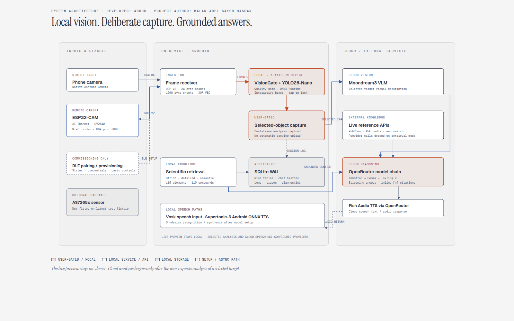
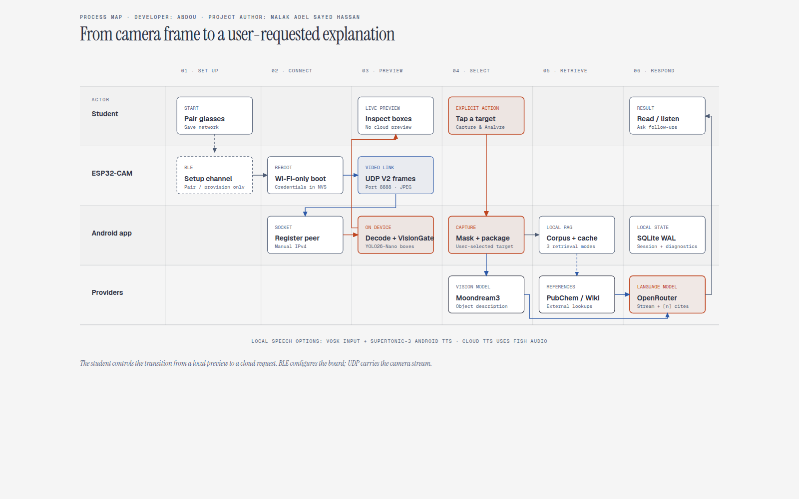
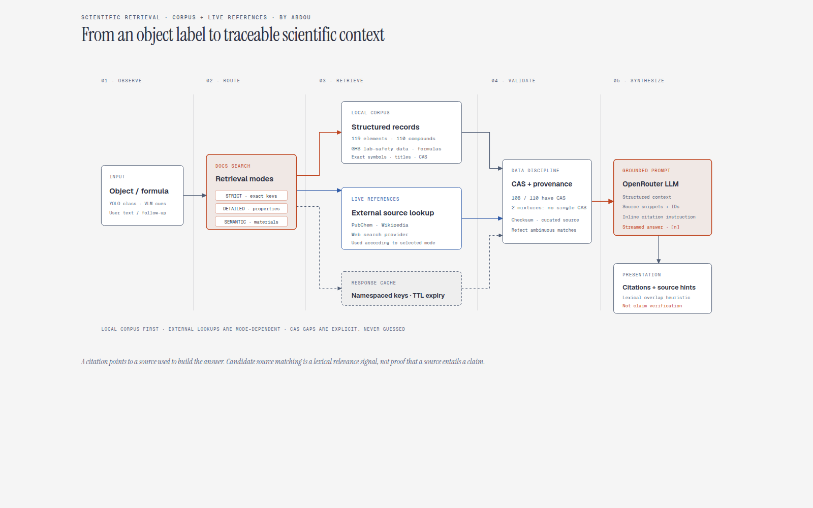

# SpectruLenPor

**النظارة الذكية لتحليل الطيف واكتشاف العناصر والمركبات الكيميائية**

**Smart scientific glasses for object-aware chemistry and spectrum exploration**

A student research prototype by **Malak Adel Sayed Hassan** and **Abdou**.

-3DDC84?style=flat&logo=android&logoColor=white)

---

## What it is

SpectruLenPor is a low-cost smart-glasses and Android research prototype developed in Egypt. An AI-Thinker ESP32-CAM with an OV2640 camera can act as a remote camera source; an Android phone can also use its own camera. The Flutter app combines live, on-device object detection with user-triggered image analysis and a bilingual scientific chat experience.

The app uses **YOLO26-Nano through ONNX Runtime on Android** to draw interactive object boxes. The user chooses a target and explicitly starts analysis. A cloud vision model describes the selected subject, retrieval combines a bundled chemistry corpus with external references, and an OpenRouter language model streams an answer with inline citations. Voice input and speech output have local Android options as well as cloud-backed services.

This is a working software and hardware prototype, not a calibrated scientific instrument. In particular, the optional spectral sensor is not installed on the current hardware test fixture, and sustained ESP32 video throughput remains below the desired target. Those limits are called out below instead of being hidden behind optimistic badges.

## At a glance

| Area | Current implementation |
|---|---|
| App | Flutter / Dart, Android-first, English and Arabic RTL |
| Local vision | YOLO26-Nano ONNX inference, VisionGate quality checks, interactive target boxes |
| Camera sources | Android phone camera or ESP32-CAM over Wi-Fi UDP |
| Glasses setup | BLE pairing, Wi-Fi provisioning, status and commissioning controls |
| Glasses video | UDP V2 on port 8888; six 32-bit header fields, 1200-byte JPEG data payloads, frame IDs and XOR parity recovery |
| Scientific retrieval | Strict, detailed and semantic modes over local data plus live lookups |
| Bundled knowledge | 119 elements, 110 compound records, GHS lab-safety data; 108 compound records have CAS numbers and two mixtures are explicitly marked as having no single CAS |
| AI services | Moondream3 vision analysis and a configurable OpenRouter model chain |
| Speech | Android Vosk speech input; Supertonic-3 local TTS; Fish Audio through OpenRouter with Android speech fallback |
| Persistence | Nine-table SQLite database using WAL on Android |
| Desktop / web | Flutter Web is useful for UI review; native camera, BLE, YOLO and SQLite capabilities are not provided by the web build |

## Screenshots

These screenshots were captured from the Flutter Web UI in a phone-sized browser. They show the interface and layout, not a live Android camera session or real ESP32 stream. Native-only features use web stubs.

| Live detection UI | Camera permission state | Settings |
|---|---|---|
|  |  |  |

| Retrieval modes | History | Diagnostics | Arabic RTL |
|---|---|---|---|
|  |  |  |  |

##  System architecture

*Editable source: [docs/diagrams/architecture.html](docs/diagrams/architecture.html) - a self-contained HTML + inline SVG document using the [diagram-design](https://github.com/cathrynlavery/diagram-design) editorial design system. The PNG is rendered from this source.*

The important boundary is intentional: camera preview and YOLO inference run on the phone. A user-triggered analysis sends the selected capture to configured cloud services. BLE is used for setup and commissioning; it is **not** the video transport.

## Capture and analysis flow

*Editable source: [docs/diagrams/pipeline.html](docs/diagrams/pipeline.html).*

##  Scientific retrieval

*Editable source: [docs/diagrams/scientific-rag.html](docs/diagrams/scientific-rag.html).*

The retrieval layer has three modes:

- **Strict** prioritizes exact symbols, formulas, CAS numbers and canonical titles.
- **Detailed** retrieves structured element, compound and lab-safety properties.
- **Semantic** expands object labels into plausible constituent materials before searching.

The corpus includes 119 elements, 110 compound records and GHS pictograms. CAS numbers are checksum-validated; 108 of the 110 compound records have a CAS value. Borosilicate glass and 304 stainless steel are mixtures, so they are marked as having no single CAS number rather than assigned an invented one.

Inline citations point to retrieved sources. The additional candidate source-matching indicator compares lexical overlap between response claims and cited source text. It is a relevance heuristic, **not** semantic entailment, fact verification or proof of scientific correctness.

## Hardware and connectivity

### ESP32-CAM

The current firmware target is an AI-Thinker ESP32-CAM with an OV2640 camera and PSRAM. The optional AS7265x sensor is supported by the design, but it was unavailable on the latest physical test fixture. Its readings must not be described as calibrated UV measurements.

The connection lifecycle is:

1. BLE is used to pair, provision Wi-Fi credentials, read setup status and issue the limited commissioning commands.
2. The board saves the Wi-Fi credentials and reboots into Wi-Fi-only operation.
3. The phone and ESP32 must be on a network that allows station-to-station traffic. The app registers the UDP peer and uses the manually entered board IPv4 address; hostname discovery through mDNS is not implemented.
4. Video and post-provisioning runtime controls use UDP on port 8888. Pausing capture keeps the UDP command channel available.

The current UDP V2 packet header contains six little-endian 32-bit fields: sequence, total data fragments, byte offset, payload size, frame ID and frame size. JPEG data fragments carry up to 1200 payload bytes. Strided XOR parity packets allow a receiver to reconstruct one missing fragment per parity group. The Flutter receiver and firmware share this framing contract.

### Throughput is still a work in progress

The goal is 20-30 FPS at a useful resolution. **That target has not been achieved.** Selected firmware builds have delivered and decoded JPEG frames, but sustained results have varied. One 60-second AMPDU-on soak measured 210 frames (about 3.5 FPS) without incomplete frames or protocol errors. Later runs were inconsistent; the latest AMPDU-off soak measured about 1.5 FPS, one incomplete frame and a control timeout.

Treat these measurements as commissioning evidence from a specific board, access point and test profile, not as a performance guarantee. Resolution, frame cadence, packet loss and long-run reliability still need hardware work. See the [dated engineering log](WORKLOG.md) and [firmware hardware validation notes](docs/firmware-hardware-validation.md).

## Implementation status and verification

| Component | Current status |
|---|---|
| Android UI, English/Arabic localization and responsive layouts | Implemented; Flutter Web screenshots are UI-only |
| Local YOLO26-Nano detection and VisionGate | Implemented; Android hardware accuracy and latency are not benchmarked |
| OpenRouter model discovery, model tests and custom free-model configuration | Implemented; catalog visibility does not prove that a model will complete an authenticated request |
| Moondream3 selected-object analysis | Implemented; live authenticated provider verification remains environment-dependent |
| Three-mode scientific retrieval and inline citations | Implemented and unit-tested |
| Candidate source matching | Implemented as a lexical relevance heuristic only |
| SQLite WAL storage, diagnostics and history | Implemented; Android runtime verification is distinct from web/test fallback behavior |
| BLE provisioning and session lifecycle | Implemented; phone-level commissioning still needs repeatable end-to-end validation |
| UDP V2 firmware sender and Flutter receiver | Implemented; real sustained delivery remains unreliable and below target |
| Vosk speech input and Supertonic-3 Android TTS | Implemented; first-use model download and device execution are required |
| Fish Audio TTS | Implemented through OpenRouter with Android speech fallback |
| Production Android signing | Not complete; a production keystore has not been supplied |
| Optional AS7265x spectral readings | Not verified on the latest physical fixture |

### Latest verification checkpoint

The latest full Flutter run recorded in the 20 November work log completed with **218 passing, 4 skipped and 13 failing tests**. Two follow-up fixes were then made: the raw ESP probe now skips when `ESP32_TEST_IP` is not configured, and the markdown-to-speech sanitizer was fixed to strip inline-code backticks. The focused TTS and speech-correction suites passed **13/13** after those fixes. The complete Flutter suite has **not** been rerun since, so the earlier totals are not a final post-fix result.

A full-project `flutter analyze` attempt did not complete in the constrained shell. No clean analyzer result is claimed here.

Firmware checks at the latest checkpoint included **3/3 C protocol tests** and **139 UDP testbench tests** passing; the firmware Python suite also passed. Host tests validate protocol and scheduling logic, but they do not substitute for a stable Android-to-board radio link or an extended physical soak.

The current known state and historical test evidence are recorded in [WORKLOG.md](WORKLOG.md). Reproduction steps and lower-level notes are in the [firmware README](firmware/README.md) and [hardware validation document](docs/firmware-hardware-validation.md).

## Privacy and service boundaries

Live preview and YOLO detection are local to the Android device. The app does not automatically send every preview frame to the cloud. When the user starts selected-object analysis, the capture and associated prompt/context may be sent to configured services such as Moondream and OpenRouter. Live retrieval may also contact PubChem, Wikipedia and web-search providers. Cloud TTS sends speech text to its configured provider.

The app offers model and cloud-policy settings, but users should still review which providers and credentials are configured before using it with private imagery or sensitive material. Local YOLO remains on-device.

## Requirements

| Target | Requirement |
|---|---|
| Android phone | Android 12 or later (min SDK 31) |
| Android build toolchain | Flutter 3.19+, Dart 3.3+, JDK 17, Android compile SDK 37 / target SDK 36 |
| Firmware | ESP-IDF 5.5.1, AI-Thinker ESP32-CAM, OV2640 camera; PSRAM recommended |
| Web | Flutter Web for layout and UI review; native camera, YOLO, BLE and SQLite features are unavailable there |
| Optional sensor | AS7265x on the configured I2C pins; not installed on the latest validation fixture |

## Quick start

### 1. Install Flutter

Install Flutter stable and confirm that Android tooling is available:

~~~bash
flutter doctor
~~~

Use Flutter 3.19 or later with Dart 3.3 or later. Android builds also require JDK 17 and the Android SDK components listed above.

### 2. Clone and configure API keys

~~~bash
git clone https://github.com/abdou-da0wew/SpectrulenPor.git
cd SpectrulenPor
flutter pub get
cp assets/config/secrets.example.json assets/config/secrets.json
~~~

Fill in only the providers you intend to use:

~~~json
{
  "moondream": "YOUR_MOONDREAM_API_KEY",
  "openrouter_llm": "YOUR_OPENROUTER_LLM_KEY",
  "openrouter_tts": "YOUR_OPENROUTER_TTS_KEY"
}
~~~

The app also exposes API-key settings. Keep real credentials out of commits, screenshots and diagnostic logs. The local Supertonic model is downloaded on demand rather than stored in the Git repository.

### 3. Run on Android

~~~bash
flutter run
~~~

### 4. Test and build

~~~bash
flutter analyze
flutter test --no-pub --concurrency=1
flutter build apk --debug
~~~

The commands above are reproduction commands, not a claim that the current full Flutter suite or analyzer is green. Release distribution also requires a production signing configuration.

### 5. Commission the ESP32-CAM

Follow [firmware/README.md](firmware/README.md) for the ESP-IDF build, flash and setup sequence. Do not erase the whole flash to reset Wi-Fi: saved credentials live in NVS, and the firmware deliberately avoids automatically erasing NVS after initialization failures. Use the documented, explicitly authorized NVS reset procedure when a setup reset is required.

After provisioning, place the phone and board on the same 2.4 GHz network, confirm that client isolation is disabled, enter the ESP32 IPv4 address in the app and wait for a decoded frame. A successful Wi-Fi association alone does not prove that the phone can reach the UDP socket.

## Documentation

| Document | What it covers |
|---|---|
| [Technical architecture](docs/ARCHITECTURE.md) | App pipeline, native channels, YOLO geometry, retrieval and SQLite schema |
| [Benchmarks](docs/BENCHMARKS.md) | Measured values, pending measurements and reproduction details |
| [Firmware README](firmware/README.md) | ESP-IDF setup, BLE commissioning, UDP contract and Linux testbench |
| [Hardware validation](docs/firmware-hardware-validation.md) | Board fixture, firmware builds, flash evidence and physical test limits |
| [Engineering work log](WORKLOG.md) | Dated changes, test evidence and current handoff |
| [Contributing](CONTRIBUTING.md) | Repository workflow and contribution guidance |
| [Agent instructions](AGENTS.md) | Repository-specific coding and verification rules |
| [Project context](CONTEXT.md) | Project mission and background |
| [Editable diagrams](docs/diagrams/) | HTML + inline SVG architecture, process and scientific retrieval visuals |

Regenerate all three published diagram PNGs from their HTML sources:

~~~bash
tooling/render_diagrams.sh
~~~

The renderer uses Chromium/Google Chrome. Set CHROME_BIN if the executable is installed under a non-standard name or path.

## Authors

| Name | Contribution |
|---|---|
| **Malak Adel Sayed Hassan** | Author and student researcher, Ashmounin Secondary School, Egypt |
| **Abdou** (عبد الرحمن أيمن محمد عثمان علي محمد علي العركي) · [@abdou-da0wew](https://github.com/abdou-da0wew) | Co-author; application and firmware engineering, software architecture and systems integration |

This repository currently has no open-source license. Unless a license file is added, all rights remain with the authors; do not assume that the code may be redistributed under an open-source license.
