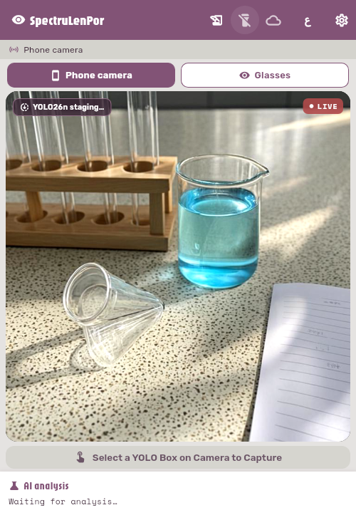
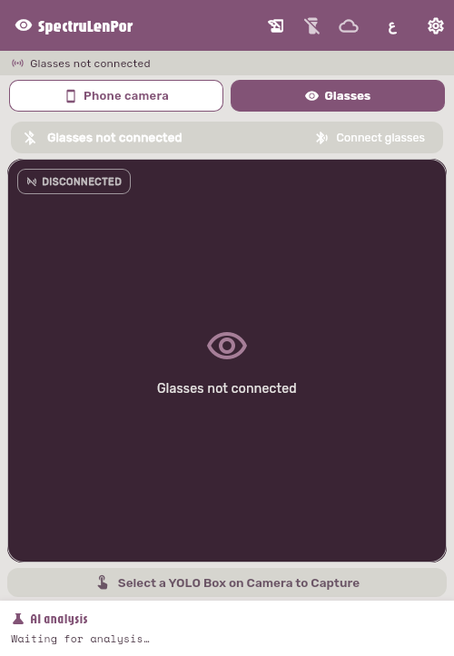
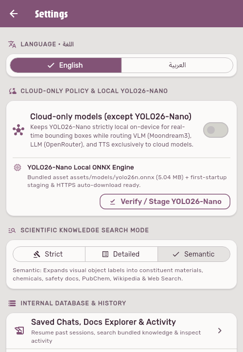
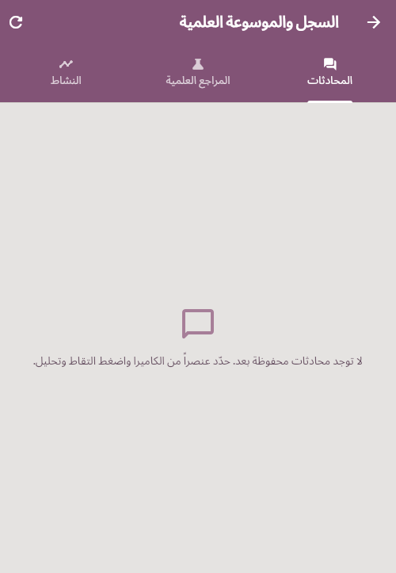
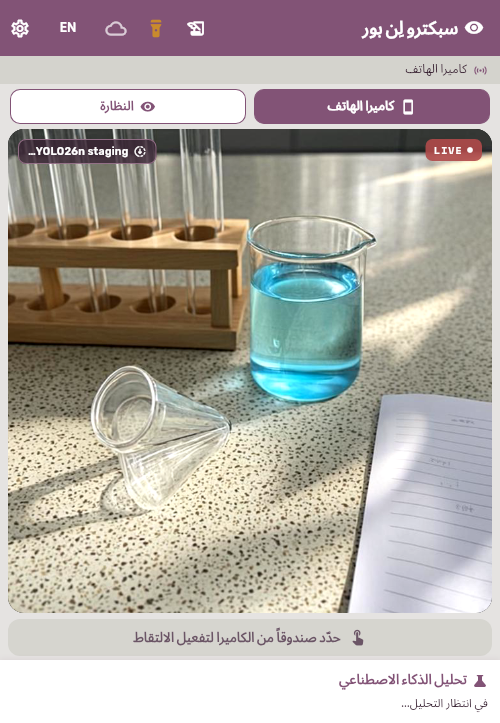
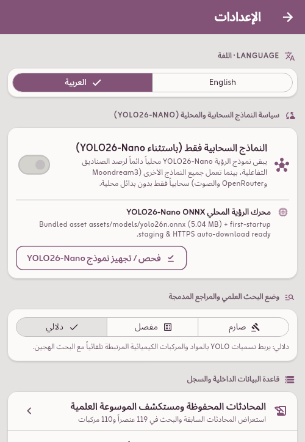
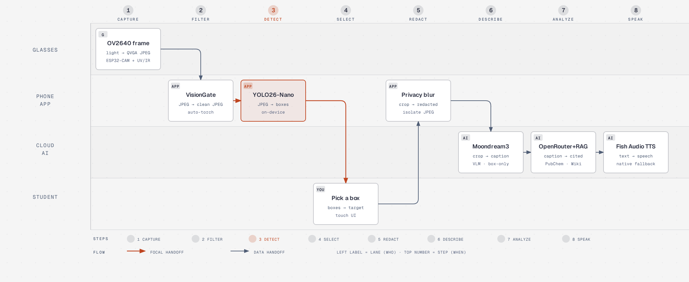
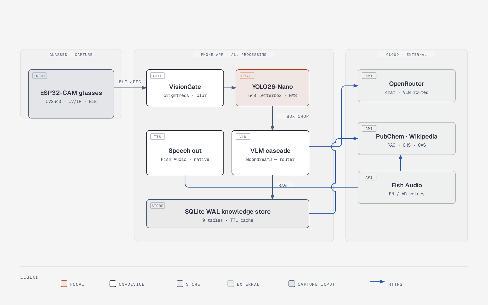

<div align="center">

&nbsp;

# SpectruLenPor

**Smart Scientific Glasses — real-time detection, spectrum awareness, and grounded chemistry answers**

**النظارة الذكية لتحليل الطيف واكتشاف العناصر والمركبات الكيميائية**

[](https://github.com/abdou-da0wew/SpectrulenPor/releases)
[](#target-devices)
[](#install-flutter-in-one-command)
[](#install-flutter-in-one-command)
[](#real-benchmarks--status)
[](#real-benchmarks--status)
[](#real-benchmarks--status)
[](#target-devices)
[](https://github.com/abdou-da0wew/SpectrulenPor/commits/main)
[](https://github.com/abdou-da0wew/SpectrulenPor/issues)
[](AGENTS.md)

</div>

---

**SpectruLenPor** is a bilingual (**English / العربية RTL**) Flutter Android application plus an ESP32-CAM BLE smart-glasses capture end. The glasses only *look* — the phone does *all* the thinking: on-device YOLO26-Nano bounding boxes, a strict user-gated capture, a privacy blur outside the selected box, a Moondream3 + OpenRouter grounded analysis chain, a 119-element + 110-compound + GHS01–GHS09 offline corpus, live PubChem/Wikipedia retrieval with `CAS` registry numbers, inline `[n]` citations with sentence-level fact-checking, auto-updating structured scientific memory, a 9-table SQLite WAL diagnostics database, and streamed EN/AR text-to-speech.

| Home — live detection | Glasses (BLE) source | Settings |
|---|---|---|
|  |  |  |
| *Camera live, YOLO staging chip, LIVE badge* | *ESP32-CAM glasses connect state* | *Cloud-only policy, search modes* |

| History (Arabic RTL) | Home (Arabic RTL) | Settings (Arabic) |
|---|---|---|
|  |  |  |
| *Saved chats, docs explorer, activity log* | *Full RTL mirror of the UI* | *Same controls, Arabic locale* |

All screenshots above are the real application running in a headless browser at phone layout (Pixel-class viewport, 412 × 915): the camera preview shows an actual live feed pointed at a beaker of copper sulfate solution.

---

## The idea

A student in a school lab points their glasses (or just their phone) at an object — a beaker of blue solution, a metal fork, a reagent bottle — and asks "what is this, is it safe?" SpectruLenPor answers **out loud, in English or Arabic, with numbered citations and a hazard banner when the UV/IR sensors or the chemistry say so**.

Three design rules shape every line of the system:

1. **The glasses are dumb, the phone is smart.** The ESP32-CAM end only streams QVGA JPEG frames and UV/IR telemetry over BLE; detection, redaction, retrieval, reasoning, and speech all happen on the phone. This keeps the wearable cheap (~1,750 EGP prototype) and the battery small.
2. **Detection is local and instant; analysis is user-gated.** YOLO26-Nano runs on-device every frame with interactive boxes. Nothing is sent to any cloud until the user selects a box and taps *Capture 2 Frames & Analyze* — and even then everything outside the selected box is blurred first.
3. **Zero guessing, ever.** The VLM may only describe the boxed object, the LLM may only cite `[n]` sources that are actually attached, CAS numbers must pass the checksum and come from PubChem, and a fact-checker re-verifies each claim against its citation.



---

## System architecture



- **Glasses zone** — AI-Thinker **ESP32-CAM** + OV2640 (QVGA JPEG), GUVA-S12SD UV sensor on `GPIO12`, analog IR sensor on `GPIO13`, flash LED on `GPIO4`; BLE GATT service `ffe0`, TX `ffe1` (notify), RX `ffe2` (write).
- **Phone zone** — VisionGate (luminance/texture gate with auto-torch hysteresis), **YOLO26-Nano** through a native ONNX Runtime 1.22.0 channel (`com.spectraglass/yolo`, per-frame letterbox 640, NMS, EP benchmark at startup), dual JPEG capture with outside-box privacy blur, the Moondream3 → OpenRouter grounded analysis cascade, and the 9-table SQLite WAL store that powers history, TTL-cached retrieval, diagnostics, and crash/hang reports.
- **Cloud zone** — OpenRouter (LLM chain + Moondream routes), Fish Audio (streamed EN/AR TTS with native offline fallback), PubChem PUG REST, and Wikipedia REST — all fetched with a `SpectruLenPor/5.5.1` user agent and TTL-cached.

The diagrams above were drawn with the [diagram-design](https://github.com/cathrynlavery/diagram-design) editorial system; the editable HTML sources live in [`docs/diagrams/`](docs/diagrams/) (`architecture.html`, `pipeline.html`) and open directly in any browser.

For the deep spec — tensor geometry, coordinate projection math, RAG modes, `<context_update>` memory schema, SQLite tables, and the cloud-only policy matrix — see [`docs/ARCHITECTURE.md`](docs/ARCHITECTURE.md).

---

## Key capabilities

 **Local on-device YOLO26-Nano** — `assets/models/yolo26n.onnx` (5.04 MB, Ultralytics 8.4.0, `end2end`, 80 COCO classes) via `onnxruntime-android:1.22.0`; startup EP benchmark (CPU vs NNAPI+FP16 vs XNNPACK) keeps the fastest working provider; latest-wins frame pipelining; 8×8 luma-signature scene-change box clearing with a 2.5 s staleness guard.

 **Interactive boxes, strict dual capture** — full-bleed `BoxFit.cover` preview, animated target lock-on reticle, and capture of `cleanJpeg` + `withBoxesJpeg` **only** when a box is selected and the user taps the button.

 **Privacy by construction** — the analysis frame blurs everything outside the selected box (+15% safety margin) before it leaves the device, and the Moondream protocol describes only the boxed object (`whatsAround` is hard-pinned empty).

 **Grounded chemistry answers** — bundled corpus (119 elements, 110 compounds with checksum-validated CAS registry numbers, GHS01–GHS09 + PPE) + live PubChem/Wikipedia/WebSearch in `strict` / `detailed` / `semantic` RAG modes; inline `[n]` citation pills, a Sources & Fact Check card, and claim-level verification.

 **Auto-updating scientific memory** — every turn the LLM emits `<context_update>{...}</context_update>`, which is stripped from the visible reply, merged non-destructively into `ConversationContext`, persisted to SQLite, and re-injected into the next system prompt.

 **Bilingual voice out** — streamed Fish Audio TTS with automatic native Android TTS fallback; complete EN/AR RTL interface with bundled fonts (Jaro, Rubik, Space Mono, Zain).

 **Diagnostics-grade persistence** — 9-table SQLite WAL database: chat sessions/messages, TTL response cache, logs, crash + hang reports (40-entry breadcrumb ring, UI-stall watchdog), telemetry events, pipeline traces, user notes, and activity.

 **BLE glasses source** — auto-reconnect with 1→16 s exponential backoff, chunked JPEG reassembly (SOI/EOI split-across-chunk safe), UV/IR hazard thresholds, and remote flashlight control.

---

## Real benchmarks & status

Measured on the project's CI-like sandbox (Linux, Flutter **3.47.9 stable** / Dart 3.13.7, 2026-11-05). Nothing here is aspirational: each row says exactly what was measured, what is implemented but needs a physical device, and what has not been tested.

| Check | Result | Status |
|---|---|---|
| Unit + widget test suite (`flutter test`) | **92 passed, 0 failed** in ~32 s | Measured |
| Static analysis (`flutter analyze`) | **0 errors**, 10 warnings, 78 infos | Measured |
| Web release build (`flutter build web --release`) | compiles clean, ~108 s | Measured |
| VisionGate thresholds, JPEG encode, CAS lookup, hazard thresholds, L10n completeness, capture gating | covered by the 92-test suite | Measured (unit level) |
| CAS corpus integrity | 108 / 110 compounds carry checksum-valid CAS (2 true mixtures correctly have none) | Measured (tool report + tests) |
| YOLO26-Nano EP startup benchmark (CPU vs NNAPI+FP16 vs XNNPACK) | implemented in `YoloInferenceChannel.kt`, reports `executionProvider` / `epBenchmarkMs` at session start | Implemented — values are device-specific by design |
| Live detection latency / FPS on Android hardware | — | Pending physical-device measurement |
| Local Moondream GGUF JNI tier (`moondream_jni.cpp`) | implemented | Pending physical-device measurement |
| Android release APK build & on-device soak | not runnable in this sandbox (no Android SDK/emulator) | Not tested here |
| BLE glasses end-to-end loop with real hardware | firmware + app implemented against the shared GATT contract | Pending physical-device measurement |

The on-device rows are honest gaps, not hidden ones: `docs/YOLO26_MOBILE_OPTIMIZATION.md` tracks the export ladder (LiteRT/INT8, CoreML, ExecuTorch) and what each stage still needs to prove.

---

## Target devices

 **Android phone — the compute end**

| Requirement | Value |
|---|---|
| OS | Android 12+ (`minSdk 31`, `targetSdk`/`compileSdk 36`) |
| Package | `com.spectraglass.app` |
| Camera | any rear camera (preview at `ResolutionPreset.high`) |
| Storage | ~40 MB app + model staging (5.04 MB bundled ONNX) |
| Network | optional — cloud tiers degrade gracefully offline |

 **Smart glasses — the capture end**

The project uses the **AI-Thinker ESP32-CAM (ESP32-S + OV2640)** programmed through the **ESP32-CAM-MB** micro-USB shield. Procured from Maker Selectronics (Egypt):

| Part | Role | Source |
|---|---|---|
| ESP32-CAM (ESP32-S, WiFi/BT, OV2640 2 MP) | camera + BLE capture end, UV/IR ADC inputs, flash LED | [Maker Selectronics — ESP32-CAM](https://makerselectronics.com/product/esp32-cam-esp32-s-wifibluetooth-with-ov2640-camera-module/) |
| ESP32-CAM-MB (micro-USB programmer shield) | CH340 USB-UART flashing + 5 V power + serial monitor — no FTDI wiring needed | [Maker Selectronics — ESP32-CAM-MB](https://makerselectronics.com/product/esp32-cam-mb-micro-module-esp32-cam/) |

Wiring, pinout, the full BLE GATT contract, and the Arduino IDE flashing steps live in [`firmware/README.md`](firmware/README.md).

### Hardware bill of materials (prototype)

| Component | Estimated cost (EGP) |
|---|---|
| AI-Thinker ESP32-CAM + OV2640 (Maker Selectronics) | ~600 |
| ESP32-CAM-MB programmer shield (Maker Selectronics) | ~120 |
| GUVA-S12SD UV sensor + analog IR sensor | ~350 |
| TP4056 Li-ion charging module + rechargeable cell | ~250 |
| Eyeglass frame mount, enclosure & wiring | ~430 |
| Android smartphone (existing user device) | 0 |
| Software & AI stack (Flutter, ONNX Runtime, SQLite, Moondream/OpenRouter free tiers) | 0 |
| **Total prototype** | **≈ 1,750 EGP** (within the 2,500–6,000 EGP school-project budget) |

---

## Repository status

| Area | State |
|---|---|
| Release | `v5.5.1+16` on `main` — all audit rounds merged (PR #3, #4, #5) |
| Tests | 92/92 passing; analyzer 0 errors |
| Open work | on-device benchmark capture (needs hardware), release-signing pipeline for store distribution |
| Agent docs | [`AGENTS.md`](AGENTS.md) — contributor/agent handbook · [`CONTEXT.md`](CONTEXT.md) — project facts and invariants · [`WORKLOG.md`](WORKLOG.md) — dated engineering log |
| Docs | [`docs/ARCHITECTURE.md`](docs/ARCHITECTURE.md) · [`docs/YOLO26_MOBILE_OPTIMIZATION.md`](docs/YOLO26_MOBILE_OPTIMIZATION.md) · [`tooling/README.md`](tooling/README.md) · [`assets/docs/README.md`](assets/docs/README.md) · [`firmware/README.md`](firmware/README.md) |

~21,700 lines of Dart, Kotlin, C++, Arduino, and Python across `lib/`, `android/`, `firmware/`, `tooling/`, and `test/`.

---

## Install Flutter in one command

**Windows** (PowerShell, no admin required — downloads the official stable archive, extracts, and adds it to your user PATH):

```powershell
irm https://storage.googleapis.com/flutter_infra_release/releases/stable/windows/flutter_windows_3.47.9-stable.zip -OutFile $env:TEMP\flutter.zip; Expand-Archive $env:TEMP\flutter.zip -DestinationPath $env:USERPROFILE -Force; [Environment]::SetEnvironmentVariable("Path", [Environment]::GetEnvironmentVariable("Path","User") + ";$env:USERPROFILE\flutter\bin", "User")
```

(Chocolatey users: `choco install flutter -y`.) Newer stables are listed in the official [releases JSON](https://storage.googleapis.com/flutter_infra_release/releases/releases_windows.json) — swap the version in the URL.

**Linux** (snap, recommended by Canonical's Flutter distribution):

```bash
sudo snap install flutter --classic
```

(No snap? One command with curl + tar on any glibc distro:)

```bash
curl -fsSL https://storage.googleapis.com/flutter_infra_release/releases/stable/linux/flutter_linux_3.47.9-stable.tar.xz | tar -xJ -C $HOME && export PATH="$HOME/flutter/bin:$PATH"
```

Then `flutter doctor` and you are ready.

---

## Build & run

1. **Clone and fetch**

   ```bash
   git clone https://github.com/abdou-da0wew/SpectrulenPor.git
   cd SpectrulenPor
   flutter pub get
   ```

2. **Configure cloud keys** (or enter them later in Settings — the app runs fully offline for detection without any keys):

   ```bash
   cp assets/config/secrets.example.json assets/config/secrets.json
   ```

   ```json
   {
     "moondream": "<Moondream key — docs.moondream.ai>",
     "openrouter_llm": "<OpenRouter LLM key — openrouter.ai/keys>",
     "openrouter_tts": "<OpenRouter TTS key — openrouter.ai/keys>"
   }
   ```

   Build-time alternative: `--dart-define=MOONDREAM_API_KEY=... --dart-define=OPENROUTER_LLM_KEY=... --dart-define=OPENROUTER_TTS_KEY=...`

3. **Verify, test, run**

   ```bash
   flutter analyze        # 0 errors expected
   flutter test           # 92 tests expected to pass
   flutter run            # on a connected Android 12+ device
   flutter build apk --release
   ```

4. **Glasses firmware** — flash [`firmware/esp32cam_glasses_firmware.ino`](firmware/esp32cam_glasses_firmware.ino) with the Arduino IDE; the ESP32-CAM-MB shield makes it a one-plug affair. Full guide: [`firmware/README.md`](firmware/README.md).

---

## Project structure

```
SpectrulenPor/
├── README.md                          # This file
├── AGENTS.md                          # Contributor / coding-agent handbook
├── CONTEXT.md                         # Project facts, invariants & glossary
├── WORKLOG.md                         # Dated engineering log
├── pubspec.yaml                       # v5.5.1+16 deps, bundled fonts, docs & model
├── docs/
│   ├── ARCHITECTURE.md                # Deep technical reference
│   ├── YOLO26_MOBILE_OPTIMIZATION.md  # Export ladder & mobile inference status
│   ├── diagrams/                      # diagram-design HTML sources + PNG exports
│   └── screenshots/                   # In-app screenshots (headless browser, phone layout)
├── assets/
│   ├── models/yolo26n.onnx            # Bundled YOLO26-Nano (5.04 MB, 80 classes)
│   ├── docs/                          # 119 elements, 110 compounds (CAS), GHS safety corpus
│   ├── fonts/                         # Jaro, Rubik, Space Mono, Zain
│   ├── config/secrets.example.json    # API key template
│   └── version.json                   # Build/version metadata
├── lib/                               # Screens, services, models, widgets, l10n (EN/AR)
├── android/                           # Kotlin channels: YoloInference, AppDatabase,
│                                      # Flashlight, Moondream + optional llama.cpp JNI
├── firmware/                          # ESP32-CAM sketch + hardware/BLE docs
├── tooling/                           # YOLO export ladder, CAS backfill, classifier tools
├── tool/real_api_smoke_test.dart      # Live cloud API smoke test
└── test/                              # 92-test suite (models, services, l10n, widgets)
```

---

## Authors

| Role | Name |
|---|---|
| Student researcher & project author | **Malak Adel Sayed Hassan** — Grade 1 Secondary, Class 3/1, Ashmounin Secondary School |
| Co-author & software/systems developer | **Abdoul-Rahman Ayman Mohamed** — architecture, app, firmware & tooling |

---

## Roadmap

Completed: full-viewport camera + BLE glasses streaming, local YOLO26-Nano with EP benchmarking, cloud-only policy toggle, interactive boxes with strict dual capture, privacy blur, grounded VLM/LLM chain with `[n]` citations and fact-checking, CAS-backfilled corpus, 9-table SQLite WAL diagnostics, bilingual RTL UI, streamed + native TTS, audit rounds 1–3 (cache-wipe fix, column alignment, TTS silence, BLE reconnect, SSE stall, signing, fonts).

Next: capture the on-device benchmark table on real hardware, release-signing pipeline for distribution, and the LiteRT/INT8 export stage from [`docs/YOLO26_MOBILE_OPTIMIZATION.md`](docs/YOLO26_MOBILE_OPTIMIZATION.md).
