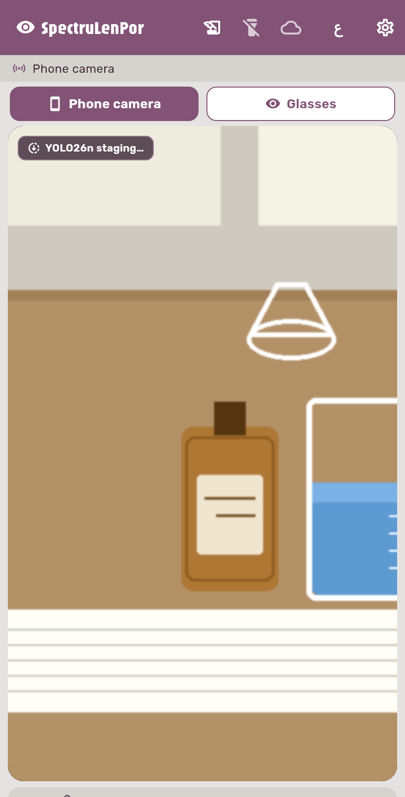
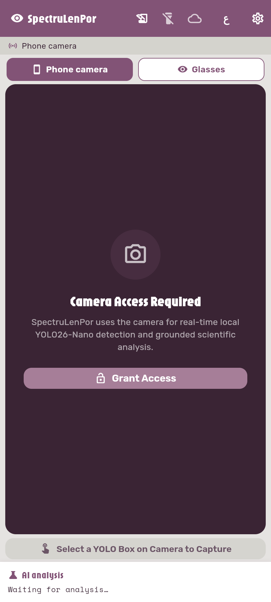
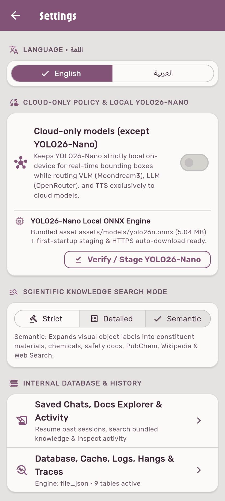
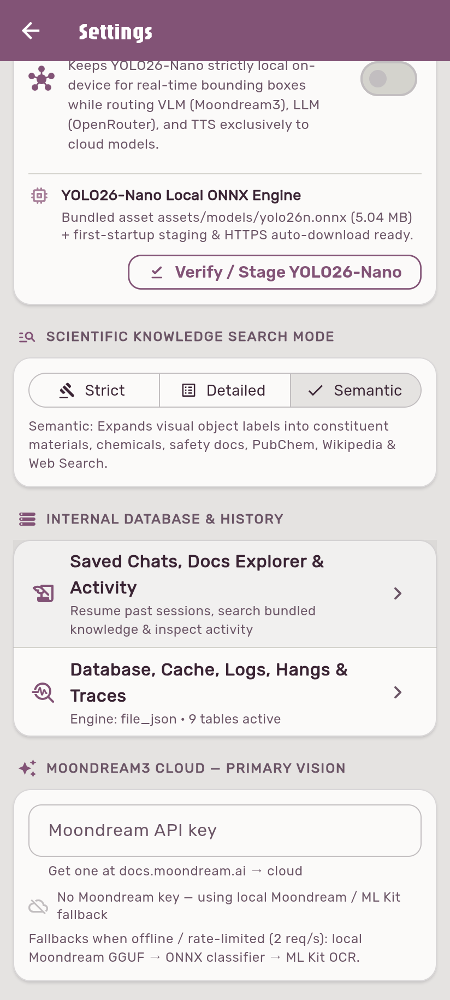
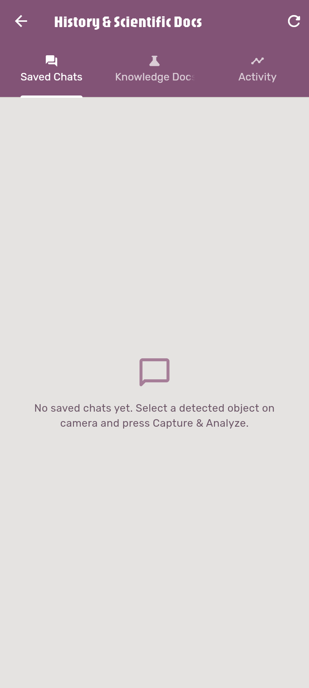
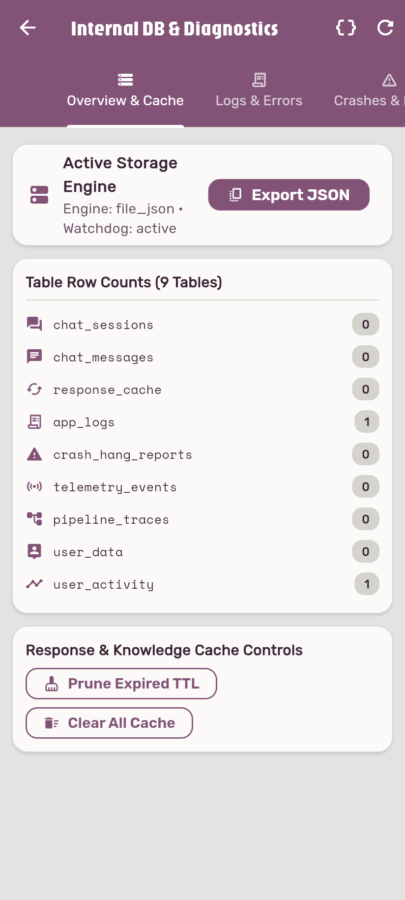
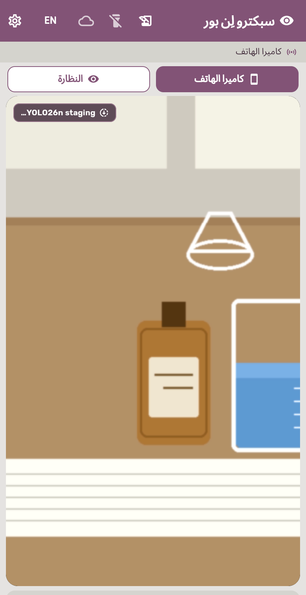
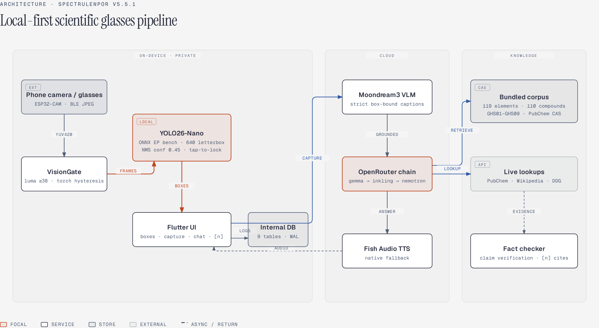
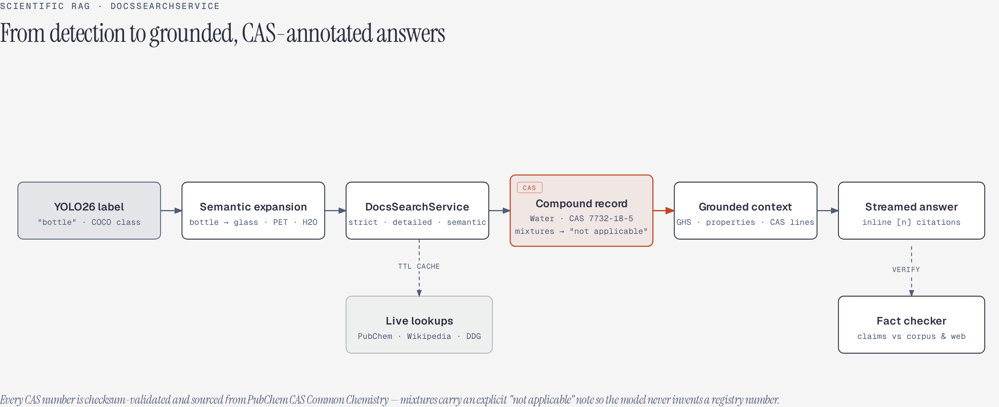

<div align="center">


# SpectruLenPor

**النظارة الذكية لتحليل الطيف واكتشاف العناصر والمركبات الكيميائية**

**Smart scientific glasses for spectrum analysis and chemical element / compound identification**


Local-first object detection · grounded chemistry answers · inline citations

<br>

| | | | | | |
|---|---|---|---|---|---|
|  |  |  | -3DDC84?style=flat&logo=android&logoColor=white) |  |  |

| | | | | | |
|---|---|---|---|---|---|
|  |  |  |  |  |  |

| | | | |
|---|---|---|---|
|  |  |  | [](CONTRIBUTING.md) |

</div>

---

 **The project idea**

SpectruLenPor is a student research project from Ashmounin Secondary School (Egypt): a pair of **low-cost smart glasses** built around an ESP32-CAM with UV/IR sensors, paired with a **bilingual (English / العربية RTL) Flutter Android app** that turns any Android 12+ phone into a scientific analysis instrument.

Point the camera at an object and the app runs **YOLO26-Nano fully on-device** to draw live, tappable bounding boxes. Lock a target and press *Capture & Analyze*: the app sends the frame to a vision-language model, grounds the answer in a **bundled scientific corpus** (119 elements, 110 compounds with PubChem-sourced CAS registry numbers, GHS lab safety) plus live lookups, and streams back a cited, fact-checked explanation with voice narration — designed to keep working in a school lab on a **2,500–6,000 EGP hardware budget** (actual prototype BOM ≈ 1,750 EGP).

Detection, quality gating, caching, storage and diagnostics all run **locally and privately on the phone**; only the heavy AI steps (VLM, LLM, cloud TTS) are cloud-based, and a **Cloud-Only policy toggle** controls exactly what leaves the device — local YOLO always stays local.

---

 **In-app screenshots**

Captured by launching the app on Flutter Web in a phone-layout headless browser (see `tooling/take_web_screenshots.py`).

| Live detection view (EN) | Camera permission gate | Settings & policies |
|---|---|---|
|  |  |  |

| RAG search modes | History & docs explorer | Internal DB diagnostics | Arabic RTL home |
|---|---|---|---|
|  |  |  |  |

---

 **System architecture**



*Editable source: [`docs/diagrams/architecture.html`](docs/diagrams/architecture.html) — built with the [diagram-design](https://github.com/cathrynlavery/diagram-design) editorial design system (HTML + inline SVG, rendered to PNG).*

---

 **Scientific RAG & CAS discipline**

Every chemical answer is grounded against a curated corpus instead of model memory. CAS registry numbers are **not handwritten**: a reproducible script (`tooling/backfill_cas_pubchem.py`) resolves each compound on PubChem, validates the check-digit, prefers the curated CAS Common Chemistry record, and refuses ambiguous results. The two true mixtures (borosilicate glass, 304 stainless steel) carry an explicit `cas_note` so the AI states *"no single CAS"* rather than inventing one.



*Editable source: [`docs/diagrams/scientific-rag.html`](docs/diagrams/scientific-rag.html).*

---

 **Implementation status — what is real and what is untested**

| Capability | Status |
|---|---|
| Local YOLO26-Nano ONNX inference + interactive boxes (tap-to-lock) | **Implemented** · unit-tested · on-device accuracy/latency **not yet benchmarked** |
| Instant stale-box clearing on fast camera sweeps + 2.5 s expiry guard | **Implemented** · unit-tested |
| VisionGate quality gate (luma ≥ 38, Laplacian ≥ 45) + torch hysteresis | **Implemented** · unit-tested |
| Privacy blur of everything outside the capture box (+15 % margin) | **Implemented** · on-device visual check pending |
| Moondream3 strict box-bound captions (never narrates the whole table) | **Implemented** · needs a live-API validation run |
| OpenRouter prompt discipline (target-scoped, zero-guessing, citation rules) | **Implemented** · smoke script `tool/real_api_smoke_test.dart` pending a live run |
| CAS backfill from PubChem (checksum + Common Chemistry anchored) | **Implemented** · 108/110 verified · mixtures explicitly flagged · test-locked |
| 3-mode scientific RAG (strict / detailed / semantic) + TTL caching | **Implemented** · unit-tested |
| Inline `[n]` citation chips + claim-level fact checking | **Implemented** · widget-tested |
| TTS: streamed Fish Audio + native Android fallback (sane rate/pitch) | **Implemented** · unit-tested · live voice output untested |
| 9-table SQLite WAL database + diagnostics screens + HangWatchdog | **Implemented** · unit-tested (file_json fallback engine on web/tests) |
| BLE ESP32-CAM streaming (QVGA JPEG + UV/IR telemetry @ 5 Hz spec) | **Implemented** · parser unit-tested · **not yet tested against real hardware** |
| ESP32-CAM firmware (`firmware/esp32cam_glasses_firmware.ino`) | **Shipped as source** · not yet flashed / bench-tested |
| Release signing & R8 templates | **Configured** · no production keystore yet |
| CI (analyze + test on every push/PR) | **Implemented** · badge reflects real runs |
| Flutter Web build | **Compiles** · camera/YOLO/BLE are native-only (graceful stubs on web) |

---

 **Real benchmarks**

Measured in this repository (Flutter **3.47.9 stable**, 2026-11-05). On-device figures are intentionally **marked pending** — they require physical hardware runs and are never invented.

| Metric | Value | Status |
|---|---|---|
| Unit + widget test suite | **93 passing, 0 failing** | Measured — `flutter test` |
| `flutter analyze` | **0 issues** ("No issues found") — warnings fixed, 69 stale lints auto-fixed, deprecated APIs migrated | Measured |
| `flutter build web --release` | Compiles clean (~84 s cold compile) | Measured |
| Bundled model size | `yolo26n.onnx` **5.04 MB** (FP32, `[1,3,640,640] → [1,300,6]`, 80 COCO classes, end2end) | Verified from asset |
| Execution-provider race (CPU vs NNAPI+FP16 vs XNNPACK) | **Implemented** at session start, fastest wins | Code verified — **on-device timings pending** |
| Detection latency p50 / p95 | — | **Not yet measured** (needs Android hardware) |
| BLE frame throughput | 5 Hz QVGA JPEG design target | **Not yet measured** on hardware |
| CAS corpus coverage | **108 / 110** compounds · 2 mixtures flagged `cas_skip` | Verified · test-locked |
| Bundled corpus | 119 elements · 110 compounds · 9 GHS pictograms | Verified · test-locked |
| Prototype hardware BOM | **≈ 1,750 EGP** of the 2,500–6,000 EGP budget | From parts list |

Reproduce the software-side numbers:

```bash
flutter pub get
flutter analyze
flutter test          # 93 passing
flutter build web --release
```

---

 **Target devices**

| Target | Requirement |
|---|---|
| Android phone (primary) | Android **12+ (API 31+)**, `compileSdk 36` / `targetSdk 36`; any modern phone — YOLO26-Nano FP32 + the EP race (NNAPI / XNNPACK) keep inference fast on mid-range chips |
| Smart glasses (companion) | AI-Thinker **ESP32-CAM** (+ OV2640), GUVA-S12SD UV sensor on GPIO12, analog IR sensor on GPIO13, flash LED GPIO4, BLE GATT `ffe0/ffe1/ffe2` |
| Desktop / CI | Flutter **3.19+** (Dart 3.3+), JDK 17, Android SDK 36 |
| Web | Flutter Web build works for UI review; camera, YOLO, BLE, SQLite stay native-only |

---

 **Authors**

| | |
|---|---|
| **Malak Adel Sayed Hassan** | Author & student researcher — Grade 1 Secondary, Class 3/1, Ashmounin Secondary School |
| **Abdoul-Rahman Ayman Mohamed** ([@abdou-da0wew](https://github.com/abdou-da0wew)) | Co-author & software/systems developer |

Hardware target budget: 2,500–6,000 EGP · actual prototype BOM ≈ 1,750 EGP.

---

 **Repository status**

- **Default branch:** `main` · current version **v5.5.1+16** (`com.spectraglass.app`)
- **CI:** `.github/workflows/ci.yml` runs `flutter analyze` + `flutter test` on every push and PR. The workflow is committed and correct, but GitHub Actions jobs for this account currently die at runner startup (even a bare echo job fails with zero logs; the same pipeline passes locally), so the badge is pinned static until the owner clears the account-level Actions block under Settings -> Actions / billing.
- **History:** PR #3 vision accuracy/UX · PR #4 audit fixes (cache wipe, columns, TTS, BLE reconnect, SSE, signing, fonts) · PR #5 PubChem CAS backfill · PR #6 mixture-CAS guard · PR #7 documentation overhaul
- **Work log:** see [`WORKLOG.md`](WORKLOG.md) for the dated change history
- **License:** none yet — © authors, all rights reserved

---

 **Quick start**

### 1. Install Flutter (one command)

**Linux** (snap):

```bash
sudo snap install flutter --classic
```

**Linux** (git, no snap):

```bash
git clone https://github.com/flutter/flutter.git -b stable --depth 1 "$HOME/flutter" && export PATH="$HOME/flutter/bin:$PATH" && flutter doctor
```

**Windows** (PowerShell, one line — clone stable, add to PATH, verify):

```powershell
git clone https://github.com/flutter/flutter.git -b stable --depth 1 "$env:USERPROFILE\flutter"; $env:PATH = "$env:USERPROFILE\flutter\bin;$env:PATH"; flutter doctor
```

> Tip: to make the Windows PATH change permanent, add `%USERPROFILE%\flutter\bin` to the user PATH environment variable. Tested with Flutter **3.47.9 stable**; the app requires **3.19+**.

### 2. Clone & configure keys

```bash
git clone https://github.com/abdou-da0wew/SpectrulenPor.git
cd SpectrulenPor
cp assets/config/secrets.example.json assets/config/secrets.json
```

```json
{
  "moondream": "<Moondream API key — docs.moondream.ai>",
  "openrouter_llm": "<OpenRouter LLM key — openrouter.ai/keys>",
  "openrouter_tts": "<OpenRouter TTS key — openrouter.ai/keys>"
}
```

Keys can also be entered live in **Settings**, or injected at build time:

```bash
flutter build apk --release \
  --dart-define=MOONDREAM_API_KEY=... \
  --dart-define=OPENROUTER_LLM_KEY=... \
  --dart-define=OPENROUTER_TTS_KEY=...
```

### 3. Run

```bash
flutter pub get      # fetch dependencies
flutter analyze      # 0 errors / 0 warnings
flutter test         # 93 tests
flutter run          # run on a connected Android device
```

### 4. Build

```bash
flutter build apk --release            # Android APK
flutter build web --release            # Flutter Web (UI review build)
```

### 5. Connect the smart glasses

1. Flash `firmware/esp32cam_glasses_firmware.ino` to an AI-Thinker ESP32-CAM.
2. Wire the UV sensor to `GPIO12`, IR to `GPIO13` (`GPIO4` = flash LED) — full pinout in [`firmware/README.md`](firmware/README.md).
3. Power on (`SpectruLenPor-ESP32`) → in the app tap **Smart Glasses → Connect Glasses**.

---

 **Documentation index**

| Document | Purpose |
|---|---|
| [`docs/ARCHITECTURE.md`](docs/ARCHITECTURE.md) | Deep technical spec: pipeline, MethodChannels, RAG modes, DB schema, CAS discipline |
| [`docs/BENCHMARKS.md`](docs/BENCHMARKS.md) | Real measured numbers vs pending on-device measurements, with reproduction steps |
| [`docs/YOLO26_MOBILE_OPTIMIZATION.md`](docs/YOLO26_MOBILE_OPTIMIZATION.md) | Mobile inference ladder: EP race, LiteRT/INT8, CoreML, ExecuTorch, fine-tuning |
| [`AGENTS.md`](AGENTS.md) | Ground rules for AI coding agents working in this repo |
| [`CONTEXT.md`](CONTEXT.md) | Project context: mission, glossary, data inventory, constraints |
| [`WORKLOG.md`](WORKLOG.md) | Dated engineering work log |
| [`tooling/README.md`](tooling/README.md) | Model tooling, CAS backfill, screenshot capture scripts |
| [`firmware/README.md`](firmware/README.md) | ESP32-CAM wiring & BLE GATT protocol |
| [`assets/docs/README.md`](assets/docs/README.md) | Scientific corpus format documentation |

---

 **Hardware bill of materials (EGP)**

| Component | Cost |
|---|---|
| AI-Thinker ESP32-CAM + OV2640 camera module | ~600 |
| GUVA-S12SD UV sensor + analog IR sensor | ~350 |
| FTDI / USB-to-TTL programming adapter | ~200 |
| TP4056 Li-ion charging module + rechargeable cell | ~250 |
| Eyeglass frame mount, enclosure & wiring | ~350 |
| Android smartphone (existing user device) | 0 |
| Software & AI stack (Flutter, ONNX Runtime, SQLite, Moondream/OpenRouter free tiers) | 0 |
| **Total prototype cost** | **≈ 1,750 EGP** |

---

 **Design system**

- **Brand palette** (`lib/utils/app_theme.dart`): Alabaster Grey `#E5E3E1` · Dust Grey `#D4D3CD` · Silver `#C2BEC0` · Dusty Mauve `#A67E98` · Dusty Lavender `#825376` · Deep Plum Ink `#3A2434`.
- **Bundled offline fonts** (`assets/fonts/`, declared in `pubspec.yaml`): **Jaro** (display) · **Rubik** (UI) · **Space Mono** (scientific/telemetry) · **Zain** (Arabic RTL).
- **Iconography:** Material Icons in-app; **[Phosphor](https://phosphoricons.com) icons** in docs (`docs/assets/icons/`, MIT); **zero emojis** anywhere — in code, UI, or documentation.
- **Diagrams:** [diagram-design](https://github.com/cathrynlavery/diagram-design) editorial HTML/SVG system.

---

 **Roadmap**

**Shipped (v5.5.1)**

- [x] On-device YOLO26-Nano with EP race, instant box clearing, tap-to-lock targets
- [x] Privacy blur + strict dual capture + Moondream box-bound grounding
- [x] Citation chips, fact checking, auto-updating conversation context
- [x] CAS backfill from PubChem with checksum + Common Chemistry anchoring
- [x] Audit fixes: TTL cache wipe, column mismatches, TTS errors, BLE reconnect, SSE stall guard, font declarations
- [x] Analyzer driven to **0 issues** (all warnings fixed, deprecated `Radio`/`speech_to_text` APIs migrated) so CI runs green
- [x] 93-test suite + CI + full documentation overhaul

**Next**

- [ ] On-device benchmark runs (detection latency, EP timings) recorded in `docs/BENCHMARKS.md`
- [ ] Flash & bench-test the ESP32-CAM glasses firmware against real hardware
- [ ] LiteRT/INT8 export ladder step (see `docs/YOLO26_MOBILE_OPTIMIZATION.md`)
- [ ] Live TTS + OpenRouter + Moondream validation with production keys
- [ ] Production release keystore + tagged GitHub releases
