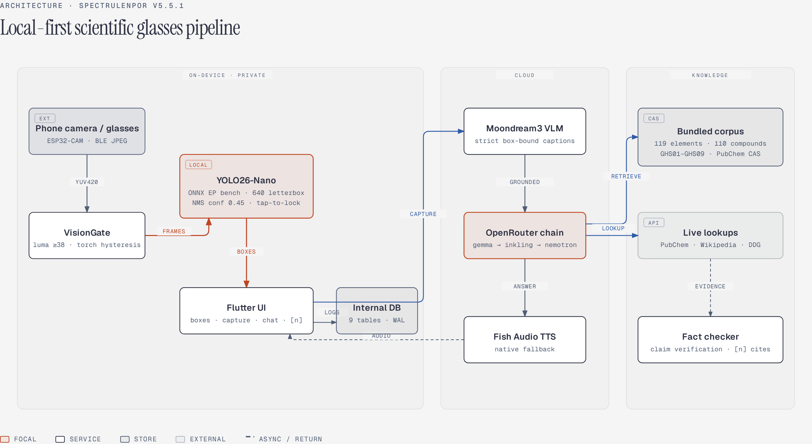

# SpectruLenPor v5.5.1 — Technical Architecture Reference

This document details the internal engineering of **SpectruLenPor** (`com.spectraglass.app`), covering the vision pipeline, ONNX tensor geometry, user-gated dual capture, 3-mode scientific RAG + fact-checking, auto-updating `ConversationContext`, and the 9-table SQLite WAL internal database.



*Editable diagram source: [`diagrams/architecture.html`](diagrams/architecture.html) (diagram-design editorial HTML/SVG system).*

---

## 0. MethodChannel registry (native Android, Kotlin)

| Channel | Implementation | Purpose |
|---|---|---|
| `com.spectraglass/yolo` | `YoloInferenceChannel.kt` | ONNX Runtime session with EP race, letterbox pre/post-processing, latest-wins inference |
| `com.spectraglass/db` | `AppDatabaseChannel.kt` | 9-table SQLite WAL store, TTL eviction, logs/crash/telemetry/trace writes |
| `com.spectraglass/flashlight` | `FlashlightChannel.kt` | Torch control (CameraManager `setTorchMode`, tablet fallback paths) |
| `com.spectraglass/moondream` | `MoondreamChannel.kt` | Optional local llama.cpp GGUF bridge (`moondream_jni.cpp`) behind cloud Moondream3 |

Everything else (camera capture, ML Kit fallbacks, TTS, speech input) runs through Dart plugins. On **Flutter Web** the native channels are unavailable and the app degrades to stubs (`onnx_backend_stub.dart`, `vision_mlkit_stub.dart`, `db_file_store_stub.dart`): UI is fully renderable (used for the README screenshots), but camera streaming, YOLO inference and SQLite are native-only.

---

## 1. End-to-End Pipeline & Cloud-Only Execution Policy

### Live Detection Loop (Continuous, Local-Only)
1. **Frame Acquisition**: `PhoneCameraService` (`ResolutionPreset.high`, background isolate YUV420 → upright JPEG) or `BluetoothCameraService` (BLE `FFD8…FFD9` JPEG reassembly — O(chunk) with SOI/EOI split-across-chunk carry — plus automatic reconnection with 1→16 s exponential backoff from `SpectruLenPor-ESP32`).
2. **VisionGate (`lib/services/vision_gate.dart`)**: Computes mean luminance and pixel standard deviation; auto-torch with hysteresis (ON below 38 mean luma, OFF at ≥ 70 so the boundary never flickers) and drops obstructed/lens-cap frames.
3. **Local YOLO26-Nano (`lib/services/yolo_detector.dart` → `YoloInferenceChannel.kt`)**: Runs strictly on-device on every gated frame and updates `RecognitionState.currentBoxes`. At session creation the channel benchmarks execution providers (CPU vs NNAPI+FP16 vs XNNPACK) and keeps the fastest working one; `imgsz` is parsed from the ONNX graph. Frames are pipelined latest-wins (a slow inference never queues stale frames), and an 8×8 luma-signature scene-change detector instantly clears boxes on fast camera sweeps (plus a 2.5 s staleness guard). **No cloud calls or dual-image captures happen automatically during live preview.**

### User-Gated Capture & Grounded Analysis (`captureAndAnalyzeSelected`)
Triggered **only** when `selectedBox != null` and the user taps **Capture 2 Frames & Analyze**:
1. **Dual Frame Generation**:
   - `cleanJpeg`: Raw unobstructed camera frame for accurate color/texture/meniscus inspection.
   - `withBoxesJpeg`: Isolate-painted copy (`_paintBoxesIsolate`) that first **blurs everything outside the selected box (+15% safety margin)** for privacy, then features subtle lavender context outlines on unselected boxes and a high-contrast dusty-mauve double border, white corner L-brackets, center target reticle, and `SELECTED: <LABEL> (<PCT>%)` banner on the chosen object.
2. **Moondream3 Cloud VLM (`MoondreamService.analyzeSelected`)**: Inspects the privacy-blurred boxed frame through a tight object crop with a strict WHAT/STATE/TEXT/HAZARD protocol to extract `whatItIs`, `stateOfMatter`, `visibleText`, and `hazards` (with negation-aware hazard parsing). `whatsAround` is kept in the schema for compatibility but is always empty — **surroundings are never analyzed nor reported by policy**.
3. **3-Mode Scientific Retrieval (`DocsSearchService.searchByMode`)**: Queries local (`periodic_table.json`, `common_compounds.json`, `lab_safety.json`) and cloud (`PubChemService`, `WikipediaService`, `WebSearchService`) sources using `strict`, `detailed`, or `semantic` mode.
4. **Grounded LLM Synthesis (`OpenRouterService`)**: Streams Markdown with inline `[n]` citations across the fallback chain (`google/gemma-4-26b-a4b-it:free` → `liquid/inkling-small:free` → `nvidia/nemotron-3-nano-30b-a3b:free`).
5. **Automated Claim Verification (`FactCheckerService`)**: Splits factual claims (EN & AR), checks lexical/numeric overlap against cited `[n]` sources, and annotates claims as verified or unverified.
6. **Persistent Anchored Session (`ChatSession` + `InternalDatabaseService`)**: Seeds `ConversationContext`, saves both JPEG files + session + messages to SQLite WAL, and opens `ChatScreen`.

### `cloudOnly` Policy Semantics
When **Cloud-only models (except YOLO26-Nano)** is enabled (`RecognitionState.cloudOnly == true`):
- **Active locally**: `YoloDetector` (`yolo26n.onnx` via ONNX Runtime Android).
- **Active in cloud**: `MoondreamService` (cloud VLM), `OpenRouterService` (cloud LLM), `OpenRouterTtsService` (cloud streamed TTS), `PubChemService`, `WikipediaService`, `WebSearchService`.
- **Disabled**: Local `moondream_jni` GGUF, local `OnnxVisionService` classifier, local Google ML Kit labeling/OCR, and offline TTS fallback.

---

## 2. YOLO26-Nano (`assets/models/yolo26n.onnx`) Specification

| Property | Value |
|---|---|
| File Path | `assets/models/yolo26n.onnx` (staged to `filesDir/models/yolo26n.onnx`) |
| File Size | `5,040,902` bytes (~5.04 MB) |
| Producer / Ops | Ultralytics `8.4.0` (`pytorch`), ONNX IR v10, Opset 22 |
| Graph Mode | `end2end=True`, `stride=32`, 80 COCO classes |
| Input Tensor | `images` — `FLOAT32 [1, 3, imgsz, imgsz]` (NCHW, RGB normalized `0.0..1.0`; `imgsz` parsed from the graph, default 640) |
| Output Tensor | `output0` — `FLOAT32 [1, 300, 6]` (`[x1, y1, x2, y2, score, class_id]` in `0..imgsz` letterboxed space) |
| Execution Provider | Benchmarked at startup: NNAPI+FP16 → XNNPACK → CPU; the fastest working session wins (`YoloInferenceChannel.status` exposes `executionProvider` / `epBenchmarkMs` / `inputSize`) |

### Coordinate Projection Math
1. **Pre-processing (`YoloInferenceChannel.kt`)**:
   - Reads EXIF rotation (`ExifInterface`) so portrait frames are rotated upright `(srcW, srcH)` prior to scaling.
   - Computes uniform scale `r = min(640 / srcW, 640 / srcH)`, resized dimensions `(newW, newH)`, and symmetric pad `(padX, padY) = ((640 - newW) / 2, (640 - newH) / 2)` filled with `114 / 255.0f`.
2. **Un-letterboxing**:
   - `nx1 = ((x1 - padX) / r) / srcW`, `ny1 = ((y1 - padY) / r) / srcH`, clamped to `[0, 1]`.
3. **Viewport Overlay (`BoundingBoxOverlay`)**:
   - Applies identical `BoxFit.cover` scale and center-crop offset (`sourceAspectRatio = previewW / previewH`) so interactive boxes align pixel-for-pixel with `CameraPreview`.

---

## 3. Knowledge Corpus & 3 Search Modes (`DocsSearchService`)

| Mode | Retrieval Strategy | Best For |
|---|---|---|
| `DocsSearchMode.strict` | Exact chemical symbol (`Au`, `Fe`), molecular formula (`H2SO4`, `NaCl`), CAS number (`7732-18-5`), or exact canonical title; exact PubChem & Wikipedia title lookups only. | Quantitative chemistry lookups without fuzzy noise. |
| `DocsSearchMode.detailed` | Full 26-field element cards (atomic mass, electron configuration, electronegativity, ionization energy, atomic radius, oxidation states, density, °C/K phase points) + compound/GHS cards + PubChem + Wikipedia + Web Search. | Deep study of physical, atomic, and safety properties. |
| `DocsSearchMode.semantic` | Maps visual YOLO object classes to constituent materials/chemicals (e.g., `cup`/`beaker` → borosilicate glass, water, caffeine; `cell phone` → LiCoO2, ITO, silicon, polycarbonate; `scissors`/`fork` → 304 stainless steel, Fe, Cr, Ni) + character-trigram cosine/Jaccard fuzzy matching + full cloud hybrid retrieval. | Camera-first exploration of real-world objects and labware. |

**CAS Registry Numbers:** `common_compounds.json` carries a checksum-validated `cas` field for 108 of 110 compounds. The two true mixtures — borosilicate glass, 304 stainless steel — have **no** CAS by nature: they carry `cas_skip: true` plus a human-readable `cas_note`, which the detailed-mode formatter turns into `CAS: not applicable - <cas_note>` so the model states the absence instead of inventing a registry number. Values were backfilled from PubChem via `tooling/backfill_cas_pubchem.py` (CAS Common Chemistry / PUG-View as primary source; polymers verified via Wikipedia/Wikidata and pinned; `cas_skip` entries are never re-queried). A query whose digits normalize to a bundled CAS (`7732-18-5`, `7732 18 5`) returns that compound as the **top local hit** in every mode, and compound citation snippets include `CAS: <number>` so the grounded LLM cites exact registry numbers instead of inventing them.

---

## 4. Auto-Updating Structured `ConversationContext`

Every system prompt sent to OpenRouter includes:
1. `AnchorContext.toSystemPrompt()` — immutable capture metadata + Moondream structured visual summary.
2. `ConversationContext.toSystemPromptBlock()` — current accumulated structured state (`turnCount`, `objectIdentified`, `userGoal`, `chemicalFormula`, `stateOfMatter`, `physicalProperties`, `chemicalProperties`, `composition`, `formation`, `commonUses`, `hazards`, `sceneContext`, `labFindings`, `safetyProtocols`, `relatedCompounds`, `establishedFacts`, `openQuestions`, `referencedEntities`, `userNotes`, `extra`).
3. Grounded `[1]..[k]` reference snippets for the turn.

At the end of every reply, the LLM appends:
```xml
<context_update>{"chemicalFormula":"CuSO4·5H2O","stateOfMatter":"solid","establishedFacts":["Blue triclinic pentahydrate crystal"]}</context_update>
```
`ConversationContext.extractFromResponse` strips the block (including partial streaming tails via `stripPartialStreamBlock`), merges scalar updates and deduplicated list entries, increments `turnCount`, and persists the updated JSON into `chat_sessions.running_context_json`.

---

## 5. Internal Database Schema (`com.spectraglass/db`)

Implemented natively in `AppDatabaseChannel.kt` (`SQLiteOpenHelper` with `PRAGMA journal_mode=WAL` and `synchronous=NORMAL`) and mirrored in `InternalDatabaseService` (`lib/services/internal_db_service.dart`):

| Table | Purpose & Key Columns |
|---|---|
| `chat_sessions` | `id`, `title`, `selected_label`, `selected_box_json`, `moondream_json`, `first_context`, `running_context_json`, `clean_jpeg_path`, `boxed_jpeg_path`, `locale`, `message_count`, `created_at`, `updated_at` |
| `chat_messages` | `id`, `session_id`, `seq`, `role`, `content`, `citations_json`, `verified_count`, `unverified_count`, `model_used`, `latency_ms`, `created_at` |
| `response_cache` | `cache_key` (`namespace:normalized_query`), `namespace`, `query`, `payload_json`, `hit_count`, `created_at`, `expires_at`. TTL eviction compares with `CAST(? AS INTEGER)` — args bind as TEXT (see below) |
| `app_logs` | `id`, `level` (`INFO`/`WARN`/`ERROR`), `tag`, `message`, `stack_trace`, `metadata_json`, **`ts`** |
| `crash_hang_reports` | `id`, `kind` (`flutter_error`, `uncaught_async`, `ui_hang`), `summary`, `stack_trace`, `breadcrumbs_json` (last 40 events), `app_state_json`, `fatal`, **`ts`** |
| `telemetry_events` | `id`, `channel`, `uv_raw`, `ir_raw`, `uv_pct`, `ir_pct`, `hazard`, `metrics_json`, **`ts`** |
| `pipeline_traces` | `id`, `trace_id`, `span_name`, `duration_ms`, `status`, `attributes_json`, `started_at` |
| `user_data` | `key`, `category`, `value_json`, `updated_at` |
| `user_activity` | `id`, `action`, `target`, `details_json`, **`ts`** |

**Column-name rule:** `chat_sessions` / `chat_messages` / `response_cache` use `created_at`; every other timestamped table uses **`ts`** (and `pipeline_traces` uses `started_at`, `user_data` uses `updated_at`). Readers must match these names — the v5.5.0 diagnostics/history screens read `created_at` everywhere and displayed empty timestamps.

**whereArgs binding rule:** `android.database.sqlite` binds ALL whereArgs as TEXT (the channel passes them through as strings). Numeric comparisons against INTEGER columns must wrap the placeholder in `CAST(? AS INTEGER)` — before v5.5.1 `expires_at <= '1770000000000'` matched every row and silently wiped the response cache on each launch.
