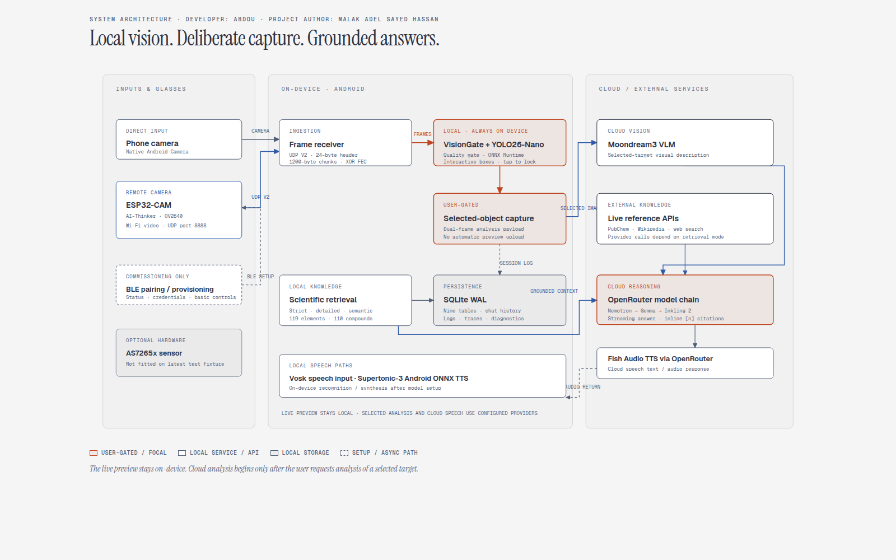
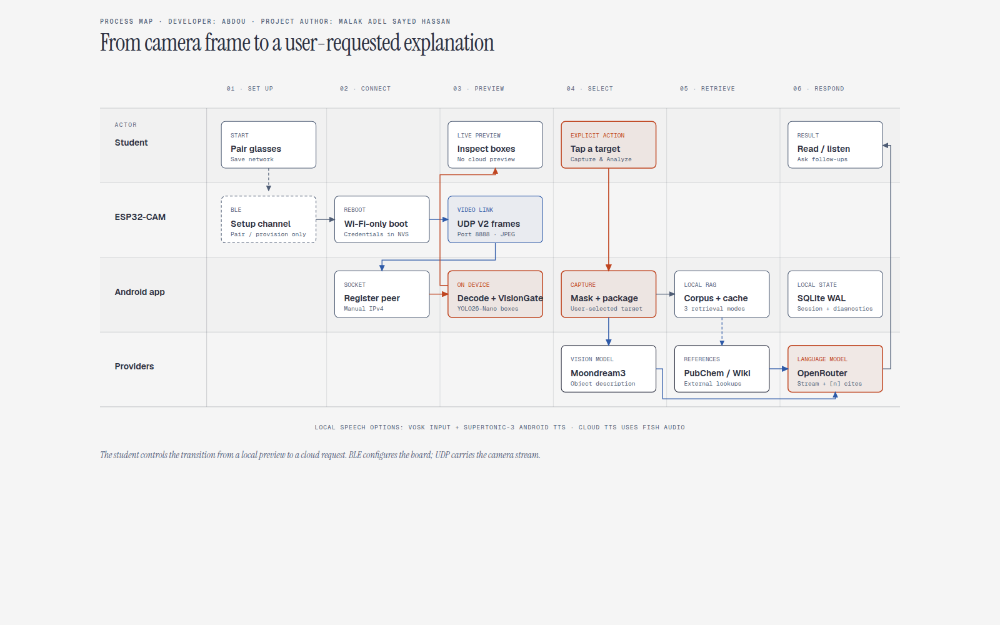

# SpectruLenPor v5.5.1 — Technical Architecture Reference

This document details the internal engineering of **SpectruLenPor** (`com.spectraglass.app`), covering the vision pipeline, ONNX tensor geometry, user-gated dual capture, 3-mode scientific RAG + candidate lexical source matching, auto-updating `ConversationContext`, and the 9-table SQLite WAL internal database.



*Editable diagram source: [`diagrams/architecture.html`](diagrams/architecture.html) (diagram-design editorial HTML/SVG system).*

The step-by-step capture/analysis swimlane across the four actors (glasses, phone app, cloud AI, student):



*Editable source: [`diagrams/pipeline.html`](diagrams/pipeline.html).*

---

## 0. MethodChannel registry (native Android, Kotlin)

| Channel | Implementation | Purpose |
|---|---|---|
| `com.spectraglass/yolo` | `YoloInferenceChannel.kt` | ONNX Runtime session with EP race, letterbox pre/post-processing, latest-wins inference |
| `com.spectraglass/db` | `AppDatabaseChannel.kt` | 9-table SQLite WAL store, TTL eviction, logs/crash/telemetry/trace writes |
| `com.spectraglass/flashlight` | `FlashlightChannel.kt` | Torch control (CameraManager `setTorchMode`, tablet fallback paths) |
| `com.spectraglass/moondream` | `MoondreamChannel.kt` | Optional local llama.cpp GGUF bridge (`moondream_jni.cpp`) behind cloud Moondream3 |

Everything else (camera capture, ML Kit fallbacks, TTS, speech input) runs through Dart plugins. On **Flutter Web** the native channels are unavailable and the app degrades to stubs (`onnx_backend_stub.dart`, `vision_mlkit_stub.dart`, `db_file_store_stub.dart`): UI is fully renderable (used for the README screenshots), but camera streaming, YOLO inference and SQLite are native-only.

---

## 1. End-to-End Pipeline & Cloud-Only Execution Policy

### Live Detection Loop (Continuous, Local-Only)
1. **Frame Acquisition**: PhoneCameraService (ResolutionPreset.high, background isolate YUV420 to upright JPEG) or WifiUdpVideoService (decoded ESP32 JPEGs over UDP V2 after WiFi provisioning). BluetoothCameraService is commissioning-only: pairing, WiFi credentials, setup status and basic local controls. It discards all binary notifications and never publishes camera frames. The ESP rejects BLE stream/single-frame commands; video and post-provisioning runtime controls use UDP port 8888. Intentional provisioning reboot suppresses BLE reconnection; the UDP service does not discover devices through mDNS.
2. **VisionGate (`lib/services/vision_gate.dart`)**: Computes mean luminance and pixel standard deviation; auto-torch with hysteresis (ON below 38 mean luma, OFF at ≥ 70 so the boundary never flickers) and drops obstructed/lens-cap frames.
3. **Local YOLO26-Nano (`lib/services/yolo_detector.dart` → `YoloInferenceChannel.kt`)**: Runs strictly on-device on every gated frame and updates `RecognitionState.currentBoxes`. At session creation the channel benchmarks execution providers (CPU vs NNAPI+FP16 vs XNNPACK) and keeps the fastest working one; `imgsz` is parsed from the ONNX graph. Frames are pipelined latest-wins (a slow inference never queues stale frames), and an 8×8 luma-signature scene-change detector instantly clears boxes on fast camera sweeps (plus a 2.5 s staleness guard). **No cloud calls or dual-image captures happen automatically during live preview.**

### User-Gated Capture & Grounded Analysis (`captureAndAnalyzeSelected`)
Triggered **only** when `selectedBox != null` and the user taps **Capture 2 Frames & Analyze**:
1. **Dual Frame Generation**:
   - `cleanJpeg`: Raw unobstructed camera frame for accurate color/texture/meniscus inspection.
   - `withBoxesJpeg`: Isolate-painted copy (`_paintBoxesIsolate`) that first **blurs everything outside the selected box (+15% safety margin)** for privacy, then features subtle lavender context outlines on unselected boxes and a high-contrast dusty-mauve double border, white corner L-brackets, center target reticle, and `SELECTED: <LABEL> (<PCT>%)` banner on the chosen object.
2. **Moondream3 Cloud VLM (`MoondreamService.analyzeSelected`)**: Inspects the privacy-blurred boxed frame through a tight object crop with a strict WHAT/STATE/TEXT/HAZARD protocol to extract `whatItIs`, `stateOfMatter`, `visibleText`, and `hazards` (with negation-aware hazard parsing). `whatsAround` is kept in the schema for compatibility but is always empty — **surroundings are never analyzed nor reported by policy**.
3. **3-Mode Scientific Retrieval (`DocsSearchService.searchByMode`)**: Queries local (`periodic_table.json`, `common_compounds.json`, `lab_safety.json`) and cloud (`PubChemService`, `WikipediaService`, `WebSearchService`) sources using `strict`, `detailed`, or `semantic` mode.
4. **Grounded LLM Synthesis (`OpenRouterService`)**: Streams Markdown with inline `[n]` citations across the fallback chain (`nvidia/nemotron-3.5-super-vl:free` → `google/gemma-4-26b-a4b-it:free` → `thinkingmachines/inkling-2-small:free`).
5. **Candidate Source Matching (`FactCheckerService`)**: Splits factual claims (EN & AR), compares lexical tokens with cited `[n]` source titles/snippets, and annotates possible source matches. This is a retrieval heuristic only; it does not establish semantic entailment or scientific correctness.
6. **Persistent Anchored Session (`ChatSession` + `InternalDatabaseService`)**: Seeds `ConversationContext`, saves both JPEG files + session + messages to SQLite WAL, and opens `ChatScreen`.

### `cloudOnly` Policy Semantics
When **Cloud-only models (except YOLO26-Nano)** is enabled (`RecognitionState.cloudOnly == true`):
- **Active locally**: `YoloDetector` (`yolo26n.onnx` via ONNX Runtime Android).
- **Active in cloud**: `MoondreamService` (cloud VLM), `OpenRouterService` (cloud LLM), `OpenRouterTtsService` (cloud streamed TTS), `PubChemService`, `WikipediaService`, `WebSearchService`.
- **Disabled**: Local `moondream_jni` GGUF, local `OnnxVisionService` classifier, local Google ML Kit labeling/OCR, and offline TTS fallback.

---

## 2. YOLO26-Nano (`assets/models/yolo26n.onnx`) Specification

| Property | Value |
|---|---|
| File Path | `assets/models/yolo26n.onnx` (staged to `filesDir/models/yolo26n.onnx`) |
| File Size | `5,040,902` bytes (~5.04 MB) |
| Producer / Ops | Ultralytics `8.4.0` (`pytorch`), ONNX IR v10, Opset 22 |
| Graph Mode | `end2end=True`, `stride=32`, 80 COCO classes |
| Input Tensor | `images` — `FLOAT32 [1, 3, imgsz, imgsz]` (NCHW, RGB normalized `0.0..1.0`; `imgsz` parsed from the graph, default 640) |
| Output Tensor | `output0` — `FLOAT32 [1, 300, 6]` (`[x1, y1, x2, y2, score, class_id]` in `0..imgsz` letterboxed space) |
| Execution Provider | Benchmarked at startup: NNAPI+FP16 → XNNPACK → CPU; the fastest working session wins (`YoloInferenceChannel.status` exposes `executionProvider` / `epBenchmarkMs` / `inputSize`) |

### Coordinate Projection Math
1. **Pre-processing (`YoloInferenceChannel.kt`)**:
   - Reads EXIF rotation (`ExifInterface`) so portrait frames are rotated upright `(srcW, srcH)` prior to scaling.
   - Computes uniform scale `r = min(640 / srcW, 640 / srcH)`, resized dimensions `(newW, newH)`, and symmetric pad `(padX, padY) = ((640 - newW) / 2, (640 - newH) / 2)` filled with `114 / 255.0f`.
2. **Un-letterboxing**:
   - `nx1 = ((x1 - padX) / r) / srcW`, `ny1 = ((y1 - padY) / r) / srcH`, clamped to `[0, 1]`.
3. **Viewport Overlay (`BoundingBoxOverlay`)**:
   - Applies identical `BoxFit.cover` scale and center-crop offset (`sourceAspectRatio = previewW / previewH`) so interactive boxes align pixel-for-pixel with `CameraPreview`.

---

## 3. Knowledge Corpus & 3 Search Modes (`DocsSearchService`)

| Mode | Retrieval Strategy | Best For |
|---|---|---|
| `DocsSearchMode.strict` | Exact chemical symbol (`Au`, `Fe`), molecular formula (`H2SO4`, `NaCl`), CAS number (`7732-18-5`), or exact canonical title; exact PubChem & Wikipedia title lookups only. | Quantitative chemistry lookups without fuzzy noise. |
| `DocsSearchMode.detailed` | Full 26-field element cards (atomic mass, electron configuration, electronegativity, ionization energy, atomic radius, oxidation states, density, °C/K phase points) + compound/GHS cards + PubChem + Wikipedia + Web Search. | Deep study of physical, atomic, and safety properties. |
| `DocsSearchMode.semantic` | Maps visual YOLO object classes to constituent materials/chemicals (e.g., `cup`/`beaker` → borosilicate glass, water, caffeine; `cell phone` → LiCoO2, ITO, silicon, polycarbonate; `scissors`/`fork` → 304 stainless steel, Fe, Cr, Ni) + character-trigram cosine/Jaccard fuzzy matching + full cloud hybrid retrieval. | Camera-first exploration of real-world objects and labware. |

**CAS Registry Numbers:** `common_compounds.json` carries a checksum-validated `cas` field for 108 of 110 compounds. The two true mixtures — borosilicate glass, 304 stainless steel — have **no** CAS by nature: they carry `cas_skip: true` plus a human-readable `cas_note`, which the detailed-mode formatter turns into `CAS: not applicable - <cas_note>` so the model states the absence instead of inventing a registry number. Values were backfilled from PubChem via `tooling/backfill_cas_pubchem.py` (CAS Common Chemistry / PUG-View as primary source; polymers verified via Wikipedia/Wikidata and pinned; `cas_skip` entries are never re-queried). A query whose digits normalize to a bundled CAS (`7732-18-5`, `7732 18 5`) returns that compound as the **top local hit** in every mode, and compound citation snippets include `CAS: <number>` so the grounded LLM cites exact registry numbers instead of inventing them.

---

## 4. Auto-Updating Structured `ConversationContext`

Every system prompt sent to OpenRouter includes:
1. `AnchorContext.toSystemPrompt()` — immutable capture metadata + Moondream structured visual summary.
2. `ConversationContext.toSystemPromptBlock()` — current accumulated structured state (`turnCount`, `objectIdentified`, `userGoal`, `chemicalFormula`, `stateOfMatter`, `physicalProperties`, `chemicalProperties`, `composition`, `formation`, `commonUses`, `hazards`, `sceneContext`, `labFindings`, `safetyProtocols`, `relatedCompounds`, `establishedFacts`, `openQuestions`, `referencedEntities`, `userNotes`, `extra`).
3. Grounded `[1]..[k]` reference snippets for the turn.

At the end of every reply, the LLM appends:
```xml
<context_update>{"chemicalFormula":"CuSO4·5H2O","stateOfMatter":"solid","establishedFacts":["Blue triclinic pentahydrate crystal"]}</context_update>
```
`ConversationContext.extractFromResponse` strips the block (including partial streaming tails via `stripPartialStreamBlock`), merges scalar updates and deduplicated list entries, increments `turnCount`, and persists the updated JSON into `chat_sessions.running_context_json`.

---

## 5. Internal Database Schema (`com.spectraglass/db`)

Implemented natively in `AppDatabaseChannel.kt` (`SQLiteOpenHelper` with `PRAGMA journal_mode=WAL` and `synchronous=NORMAL`) and mirrored in `InternalDatabaseService` (`lib/services/internal_db_service.dart`):

| Table | Purpose & Key Columns |
|---|---|
| `chat_sessions` | `id`, `title`, `selected_label`, `selected_box_json`, `moondream_json`, `first_context`, `running_context_json`, `clean_jpeg_path`, `boxed_jpeg_path`, `locale`, `message_count`, `created_at`, `updated_at` |
| `chat_messages` | `id`, `session_id`, `seq`, `role`, `content`, `citations_json`, legacy `verified_count` / `unverified_count` columns now storing source-match / no-match counts, `model_used`, `latency_ms`, `created_at` |
| `response_cache` | `cache_key` (`namespace:normalized_query`), `namespace`, `query`, `payload_json`, `hit_count`, `created_at`, `expires_at`. TTL eviction compares with `CAST(? AS INTEGER)` — args bind as TEXT (see below) |
| `app_logs` | `id`, `level` (`INFO`/`WARN`/`ERROR`), `tag`, `message`, `stack_trace`, `metadata_json`, **`ts`** |
| `crash_hang_reports` | `id`, `kind` (`flutter_error`, `uncaught_async`, `ui_hang`), `summary`, `stack_trace`, `breadcrumbs_json` (last 40 events), `app_state_json`, `fatal`, **`ts`** |
| `telemetry_events` | `id`, `channel`, `uv_raw`, `ir_raw`, `uv_pct`, `ir_pct`, `hazard`, `metrics_json`, **`ts`** |
| `pipeline_traces` | `id`, `trace_id`, `span_name`, `duration_ms`, `status`, `attributes_json`, `started_at` |
| `user_data` | `key`, `category`, `value_json`, `updated_at` |
| `user_activity` | `id`, `action`, `target`, `details_json`, **`ts`** |

**Column-name rule:** `chat_sessions` / `chat_messages` / `response_cache` use `created_at`; every other timestamped table uses **`ts`** (and `pipeline_traces` uses `started_at`, `user_data` uses `updated_at`). Readers must match these names — the v5.5.0 diagnostics/history screens read `created_at` everywhere and displayed empty timestamps.

**whereArgs binding rule:** `android.database.sqlite` binds ALL whereArgs as TEXT (the channel passes them through as strings). Numeric comparisons against INTEGER columns must wrap the placeholder in `CAST(? AS INTEGER)` — before v5.5.1 `expires_at <= '1770000000000'` matched every row and silently wiped the response cache on each launch.

## 6. ESP32-CAM firmware 3.2.0

The firmware uses ESP-IDF 5.5.1. `firmware/components/main/main.c` owns command execution, camera capture, stream scheduling and GPIO state; NimBLE callbacks validate and queue commands without performing NVS, WiFi or camera work.

Queued BLE commands retain their source session through dequeue. Main reconciles session changes before execution and capture, revalidates commands at execution entry, and binds command replies and image chunks to that session. Reset/connect and notification submission share a task mutex without holding a port critical section around NimBLE calls. A command already current at execution entry can finish after disconnect, but its replies cannot migrate to the replacement connection.

WiFi timeout and GOT_IP acceptance compete under the same state lock. IP acceptance requires the current started, associated netif; a claimed timeout rejects late success. A successful disconnect request waits for STA_DISCONNECTED before another attempt. Host regressions cover controlled ordering, not real driver event delivery or FreeRTOS scheduling.

- NVS initialization failure stops boot without erasing or retrying initialization. Recovering the NVS partition requires an explicit operator action.
- No valid credential blob in NVS: initialize BLE setup only, advertising `SpectruLenPor-ESP32` with service `ffe0`, notify characteristic `ffe1` and write characteristic `ffe2`.
- A valid `0x0A + 11111` authorizes only the current connection. `0x07` saves an SSID/password pair offline and notifies the station MAC and hostname. Disconnect clears authorization.
- Paired `0x0B` requires saved credentials and reboots. The next boot initializes WiFi, not BLE. Bounded connection failure leaves credentials intact and never falls back to BLE.
- Setup-mode JPEGs use QVGA; WiFi/UDP uses SVGA when PSRAM is available. UDP keeps its four little-endian uint32 header fields and 512-byte payload fragments. Its command range remains `0x00..0x04`; pause keeps the listener open.
- Sender failures distinguish frame-wide deadline expiry from socket errors and short writes, with per-fragment attempt counts and the last actual socket result. A deadline reached before any send is not reported as an attempted socket failure.
- Reconfiguration after a WiFi-only boot requires an authorized NVS reset. The fixed setup code and UDP controls are not encrypted authentication.

The optional AS7265x uses I2C1 on GPIO13/GPIO14. No spectral readings are emitted when unavailable. The legacy UV field is its 410 nm channel, not a calibrated UV measurement. Linux hardware results are not Android integration results. Static TX buffers, legacy PHY and the latest acquisition-pause comparison have not established decoded UDP delivery; tracing and camera-DMA wrappers are diagnostic only.

See the [firmware README](../firmware/README.md) for the command contract and [hardware validation](firmware-hardware-validation.md) for measured results and limits.

## 7. Flutter glasses handoff

`RecognitionState` coordinates `GlassesSetupStage` from BLE connection through pairing, provisioning, reboot, manual IPv4 entry and decoded-frame readiness. `GlassesSetupCard` exposes the flow in the home/settings UI; messages come from the English/Arabic ARBs through `glasses_messages.dart`.

- `BluetoothCameraService` matches complete acknowledgments from normalized notifications. Provisioning requires its acknowledgment and fresh MAC/hostname; reboot requires its acknowledgment and observed disconnection. Late replies cannot complete a different session.
- BLE acquisition owns its device/subscriptions per session. Cancellation and physical disconnect run independently; failed releases remain owned for explicit close, disposal or retry admission. Generation checks reject late acquisition, old callbacks cannot alter a newer session, and pending acquisition/teardown blocks reuse. Manual close/disposal is not evidence of the ESP's reboot. These paths are covered by plugin-boundary stubs, not real Android scheduling or scans.
- The coordinator marks configuration uncertain before awaiting the credential write. Cancellation leaves that guard set because NVS may already contain the profile. Confirmed current-session success clears it. No automatic resubmission or erase follows a timeout or cancellation.
- Preferences retain the SSID, device identity, configured flag and a successfully used IPv4 address, never the password. The hostname is informational, not mDNS discovery.
- `WifiUdpVideoService` binds an exclusive ephemeral IPv4 socket and accepts only the configured peer/port. It bounds header fields and JPEG allocation, anchors frames at sequence zero, rejects gaps/conflicting duplicates, and requires JPEG decoding before readiness. Bind/readiness/stall deadlines and generation guards close stale sessions and sockets.
- Pause keeps the UDP listener active; a single request while paused does not resume streaming. UDP controls stay within `0x00..0x04`; BLE-only controls are unavailable after handoff.
- The camera placeholder scrolls under tight height constraints rather than shrinking or hiding accessible setup text.

The unchanged UDP wire has no frame ID. Ordered assembly reduces mixing risk but cannot prove rejection of every possible mixed-frame sequence. Unit/socket/widget checks do not establish real Android transport performance.

## 8. Linux testbench ownership and evidence

`firmware/testbench/engine.py` runs one hardware worker. It owns BlueZ, UART and the UDP receiver; HTTP threads only enqueue actions or read snapshots and the latest decoded JPEG. Dashboard, CLI and OpenCV never create competing UDP peers.

- `HardwareLock` uses per-user Linux locks for the adapter and canonical UART path. Standalone HIL and boot checks retain the same lease through media cleanup, UART closure and BLE disconnect. `HardwareSuite.run` relies on its caller's lease rather than acquiring a nested one.
- `MemoryUART` captures bounded evidence on the worker without a credential log or reader thread. Standalone `UARTLog` has a finite read timeout and joins its reader before closing UART/output. Partial entry and either reset-line failure still attempt all acquired-resource closes.
- Cleanup-only failures produce failed jobs/reports and clear aggregate flags. Original operation failures remain primary, with cleanup errors reported separately. CLI results and exit status are chosen only after worker shutdown and ownership release.
- A receive failure after a passed job invalidates final report health and firmware/mobile-contract flags without rewriting the historical job result. Sanitized reports are saved after receive-failure cleanup and again after worker shutdown.
- Process shutdown is persistent and separate from resettable job cancellation. Admission and worker acquisition reject shutdown; credential retrieval and the actual BlueZ write boundary check cancellation. A credential write remains uncertain until current-run decoded UDP readiness, with no automatic resend or erase.
- Dashboard, profile CLI and standalone HIL/boot entrypoints handle SIGINT/SIGTERM cooperatively and restore handlers after shutdown. Standalone handlers only record a request; checkpoints cancel waits and operations while protected teardown retains ownership. Repeated signals cannot interrupt that teardown. Native D-Bus calls must return before cancellation is observed; signal-driven live hardware teardown remains unverified.
- The loopback HTTP server validates Host/origin and `X-Testbench-Token` before mutations, bounds requests, uses safe error codes, and serves bundled fonts and ARB localization without external requests. `/api/frame.jpg` returns 204 when there is no image; an accepted send or job is not camera readiness.
- All 206 dashboard keys per locale come directly from `lib/l10n/app_en.arb` and `app_ar.arb`. There is no second translation dictionary.
- `profiles.py` reuses the HIL suites in-process. Firmware/mobile-contract flags require complete current-run UART-backed boot, persistence, decoded BLE/UDP, stream/pause, controls and integrity evidence. Smoke, soak, missing-AP and no-UART mobile-flow passes cannot establish those aggregates. Linux reports always leave Android and sensor verification pending.

`--opencv` reads the worker's frame store; `view --url` consumes loopback HTTP only. Neither owns UART, BLE or a UDP socket. Reports redact credentials/raw UART text; saved JPEG evidence still needs private handling. Live UDP/dashboard/OpenCV verification remains pending, as recorded in [hardware validation](firmware-hardware-validation.md).

## ESP32 camera transport

BLE is restricted to commissioning and the basic-control allowlist. It carries no JPEG data. After WiFi credentials are saved, the ESP reboots into WiFi-only mode. The phone registers its UDP source endpoint with command 0x0C (keepalive), then sends stream, single-frame, flash, restart, shutdown, reboot and status commands over the same UDP socket. Video uses V2 datagrams with frame IDs, 768-byte payloads, XOR parity over four interleaved sequence classes, out-of-order reassembly and RSSI-adaptive OV2640 profiles. Pausing video retains the UDP command socket; only explicit disconnect closes it.
